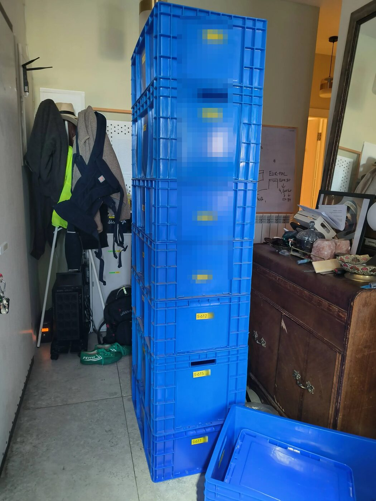
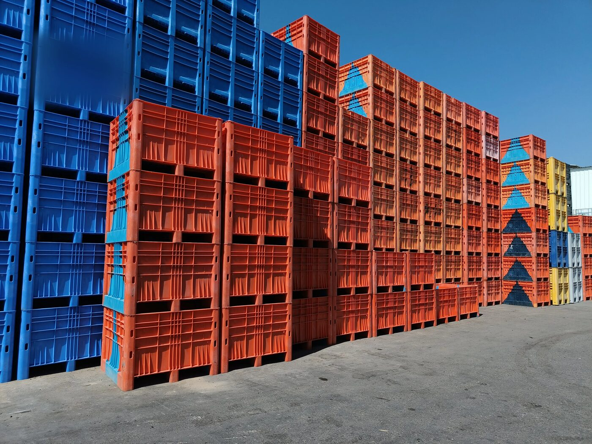
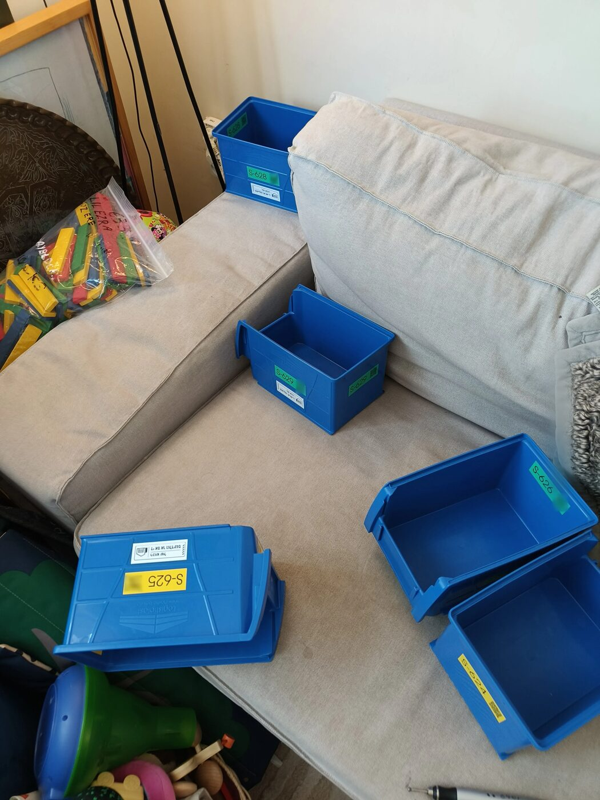
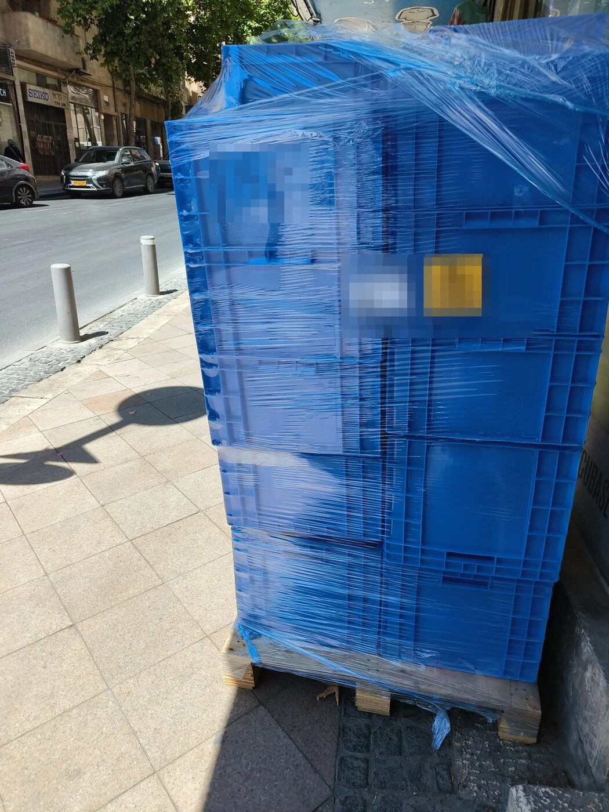

# 🏭 The Warehouse Apartment

A field manual for a home storage-and-moving system built on **industrial logistics
standards** — Euroboxes, pallets, picking bins, dollies — rather than consumer
storage products.

It exists because renting in Israel means moving often, involuntarily, and
expensively (see [The Why](docs/the-why.md) for the tenancy-law mechanics and the
cost breakdown). The system's goal is narrow and practical: **make each move cheaper,
faster, and less physically punishing than the last**, by storing belongings in the
same standardized units industry already uses to move things at scale.

The name is a running joke — visitors ask whether it's a warehouse or an apartment —
but the contents are meant as a straightforward reference for anyone who, like me,
never realized this entire ecosystem was available to individuals.

---

## Contents

| Doc | Covers |
|-----|--------|
| [The Why](docs/the-why.md) | Israel's tenancy/rental-law mechanics, the real cost of a move, jurisdiction comparison |
| [Euroboxes](docs/euroboxes.md) | The three sizes, the standard, why they replace cardboard |
| [Cost of Ownership](docs/cost-of-ownership.md) | IKEA SAMLA vs. industrial: real prices, amortized TCO, durability & UV |
| [Picking & Sorting Bins](docs/picking-and-sorting-bins.md) | Fast-access containers for the unboxing phase |
| [Moving Equipment](docs/moving-equipment.md) | Dollies, ratchet straps, improvised rolling cart |
| [Pallets, Elevators & Biomechanics](docs/pallets-elevators-biomechanics.md) | Why palletizing is non-linear; why elevator depth dominates a move |
| [Gastronorm](docs/gastronorm.md) | The same standards logic applied to the kitchen |
| [Consumables & Inserts](docs/consumables-and-inserts.md) | Turning boxes into a restockable pantry system |
| [Sourcing](docs/sourcing.md) | Buying B2B industrial gear as an individual |
| [Interoperability](docs/interoperability.md) | Global pallet / box / shelving standards by region |
| [The Shipping-Container Thesis](docs/shipping-container-thesis.md) | How the standards nest up to intermodal freight |
| [Where's My Box](docs/wheres-my-box.md) | The QR-code inventory layer |

---

## The system at a glance

| Unit | Size (cm) | Footprint | Use |
|------|-----------|-----------|-----|
| Eurobox | 60 × 40 × 23 | Euro 600×400 | Everyday / shallow storage |
| Eurobox | 60 × 40 × 34 | Euro 600×400 | Deeper loads, toolsets |
| Eurobox | 40 × 30 × 17 | Half-Euro 400×300 | Small parts |
| ACL box | 60 × 40 × 41 | Euro 600×400 | On a trolley → rolling trash/cleaning cart |
| Euro pallet | 120 × 80 | — | Move-out unit (load, jack, roll) |

Everything nests on the **600 × 400 mm** grid, which divides the **1200 × 800 mm Euro
pallet** (4 footprints/layer), which fits a shipping container. That chain of
standards is the point — details in [Interoperability](docs/interoperability.md).

---

## Finished PDF

A typeset, printable edition is generated from the markdown via
[Typst](https://typst.app/): **[`pdf/warehouse-apartment.en.pdf`](pdf/warehouse-apartment.en.pdf)**
(rebuild with `pdf/build.sh`). Photos of the system are embedded throughout.

## Photos

Photos of the real system — sourcing, the storage wall, picking bins, moving
equipment, and moving day — live in [`photos/`](photos/), organized by theme and
redacted (inventory QR codes removed, metadata/GPS stripped):

| Folder | What's in it |
|--------|--------------|
| [`photos/sourcing/`](photos/sourcing/) | The supplier yard; pallet deliveries |
| [`photos/storage-system/`](photos/storage-system/) | The storage wall, labelled Euroboxes, shelving, consumables |
| [`photos/picking-bins/`](photos/picking-bins/) | Open-front picking bins and wall hardware bins |
| [`photos/moving-equipment/`](photos/moving-equipment/) | Hand trucks, dollies, carts, labelling tools |
| [`photos/moving-day/`](photos/moving-day/) | Palletized/strapped loads, car loads, the lift |
| [`photos/extras/`](photos/extras/) | Odds and ends |

  
  
  

## Status

- ✅ **Docs** — written, expanding.
- ✅ **PDF** — English edition builds from the markdown (`pdf/`).
- ✅ **Photos** — a redacted, metadata-stripped set is in [`photos/`](photos/)
  (organized by theme) and embedded through the docs and PDF. Batch redaction tool
  in [`tools/`](tools/).
- 🎥 **Video** — in progress; releases once the finished system is in place.
- 🌐 **Hebrew** — a Hebrew edition (`pdf/warehouse-apartment.he.pdf`) is planned.

---

## Thanks

**[YosiBox](http://yosibox.com/)** (יוסיבוקס) — Israel's largest and longest-running
storage-solutions supplier. They took the time to explain a B2B system to a household
buyer and walk through every model, which is a large part of why this project exists.

## License

Docs & photos: [CC BY 4.0](https://creativecommons.org/licenses/by/4.0/). Code in
[`tools/`](tools/): [MIT](LICENSE).
