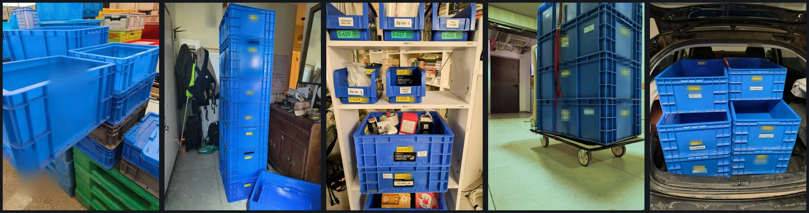
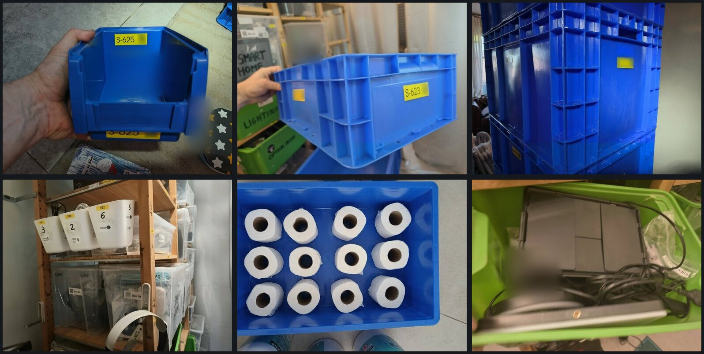
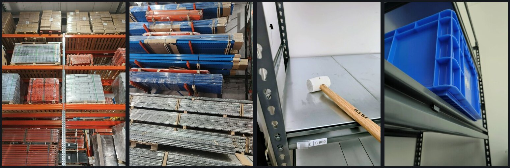
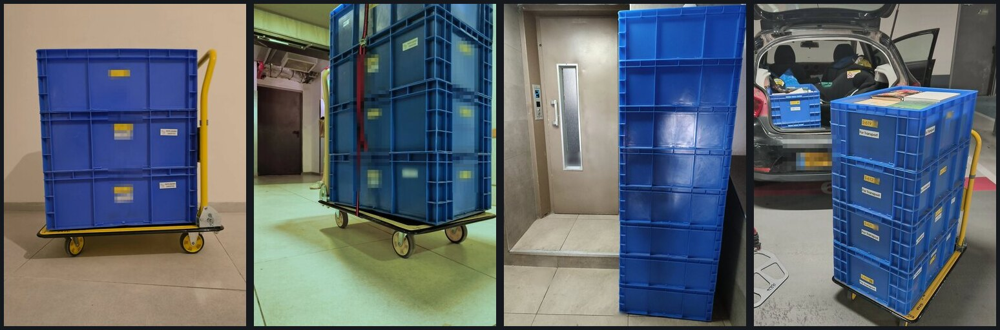
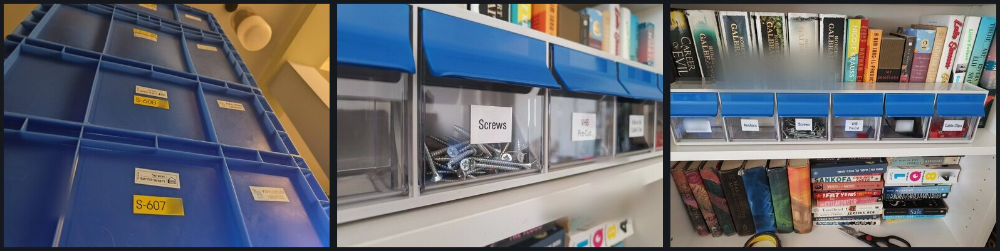
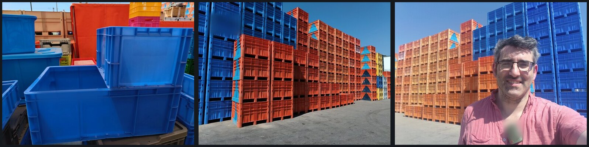

<!-- markdown="1" is for Jekyll/kramdown on the Pages site, which otherwise renders
     the contents of a block-level 
 as raw HTML. GitHub ignores the attribute. -->

# 🏭 The Warehouse Apartment

**A field manual for running a home on industrial logistics standards** — Euroboxes,
Euro pallets, boltless racking, picking bins, dollies — instead of consumer storage
products.

[**Read the manual**](#the-manual) · [**Eurobox calculator**](https://danielrosehill.github.io/eurobox-calculator/) · [**PDF edition**](pdf/warehouse-apartment.en.pdf) · [**Photos**](photos/)

---

It exists because renting in Israel means moving often, involuntarily, and
expensively (see [**The Why**](docs/the-why.md) for the tenancy-law mechanics and the
cost breakdown). The goal is narrow and practical: **make each move cheaper, faster,
and less physically punishing than the last**, by storing belongings in the same
standardized units industry already uses to move things at scale.

The name is a running joke — visitors ask whether it's a warehouse or an apartment —
but the contents are meant as a straightforward reference for anyone who, like me,
never realized this entire ecosystem was available to individuals.

---

## The system at a glance

Everything sits on the **600 × 400 mm** grid, which divides the **1200 × 800 mm Euro
pallet** four-to-a-layer, which fits a shipping container. That chain of standards is
the point — details in [Interoperability](docs/interoperability.md).

| Unit | Size (cm) | Footprint | Role |
|------|-----------|-----------|------|
| **Eurobox** | 60 × 40 × 23 | Euro 600 × 400 | Everyday / shallow storage — the daily driver |
| **Eurobox** | 60 × 40 × 34 | Euro 600 × 400 | Deeper loads, whole toolsets |
| **Eurobox** | 40 × 30 × 17 | Half-Euro 400 × 300 | Small parts; two sit on one 60 × 40 |
| **ACL** (attached-lid) | 60 × 40 × 41 | Euro 600 × 400 | The **moving** box — hinged lid, seals, nests empty |
| **Picking bin** | open front | — | Grab-access during unboxing |
| **Boltless shelving** | 60 cm deep | matches the box | Storage wall; flat-packs to the next flat |
| **Euro pallet** | 120 × 80 | — | Move-out unit — load it, jack it, roll it |

Because the footprint is shared, the formats are **interchangeable**: pack into
[ACLs](docs/attached-lid-containers.md) for the move, decant into Euroboxes for the
shelf, and back again next time — no repacking to a different size, no re-measuring
against the shelving.

---

## The manual

### Start here

| Doc | Covers |
|-----|--------|
| [**The Why**](docs/the-why.md) | Israel's tenancy/rental-law mechanics, the real cost of a move, jurisdiction comparison |
| [**Euroboxes**](docs/euroboxes.md) | The three sizes, the standard, why they replace cardboard |
| [**Interoperability**](docs/interoperability.md) | Global pallet / box / shelving standards by region — the map of the whole ecosystem |

### The containers

| Doc | Covers |
|-----|--------|
| [**Attached-Lid Containers (ACLs)**](docs/attached-lid-containers.md) | The moving-specific box: hinged lids, seals, nesting empties, the trash-cart second life |
| [**Picking & Sorting Bins**](docs/picking-and-sorting-bins.md) | Fast-access containers for the unboxing phase |
| [**Gastronorm**](docs/gastronorm.md) | The same standards logic applied to the kitchen |
| [**Consumables & Inserts**](docs/consumables-and-inserts.md) | Turning boxes into a restockable pantry system |

### The infrastructure

| Doc | Covers |
|-----|--------|
| [**Industrial Shelving**](docs/industrial-shelving.md) | Depth, beam length, boltless keyhole racking, decking, load, using the side face |
| [**Moving Equipment**](docs/moving-equipment.md) | Dollies, ratchet straps, improvised rolling cart |
| [**Pallets, Elevators & Biomechanics**](docs/pallets-elevators-biomechanics.md) | Why palletizing is non-linear; why elevator depth dominates a move |
| [**Where's My Box**](docs/wheres-my-box.md) | The QR-code inventory layer |

### Money, buying, and the bigger idea

| Doc | Covers |
|-----|--------|
| [**Cost of Ownership**](docs/cost-of-ownership.md) | IKEA SAMLA vs. industrial: real prices, amortized TCO, durability & UV |
| [**Sourcing**](docs/sourcing.md) | Buying B2B industrial gear as an individual |
| [**The Shipping-Container Thesis**](docs/shipping-container-thesis.md) | How the standards nest up to intermodal freight |

---

## Tools

### 📐 Eurobox Logistics Calculator

**<https://danielrosehill.github.io/eurobox-calculator/>**

A single-page calculator that turns a pile of Euroboxes into logistics figures —
useful before you buy them, and again before you book the van.

- **Total volume** in m³ and litres, from external dimensions
- **Euro pallet loads** (EUR-1 or EUR-6 half pallet) at a chosen max stack height,
  with per-layer layout diagrams
- **20 ft container (TEU) utilisation** by volume *and* by pallet floor positions
- **3D models** of each unit in the browser, with GLB download
- **A4 PDF report** to hand to a removals firm

No build step, no dependencies.
Source: [`danielrosehill/eurobox-calculator`](https://github.com/danielrosehill/eurobox-calculator).

### 🧊 Companion repos

| Repo | What it is |
|------|-----------|
| [eurobox-calculator](https://github.com/danielrosehill/eurobox-calculator) | The calculator above |
| [storage-box-3d-models](https://github.com/danielrosehill/storage-box-3d-models) | True-scale GLB models of Euroboxes, ACLs and picking bins |

### 🛠 In this repo

| Tool | What it does |
|------|--------------|
| [`tools/redact_qr.py`](tools/redact_qr.py) | Batch-covers inventory QR codes and strips EXIF before photos go public |
| [`tools/make_composites.sh`](tools/make_composites.sh) | Rebuilds the composite figures used on this page |
| [`pdf/build.sh`](pdf/build.sh) | Typesets the docs into the PDF edition via pandoc + Typst |

---

## Photos

Photos of the real system — redacted (inventory QR codes covered) and
metadata-stripped — live in [`photos/`](photos/), organized by theme.

**The storage system**

**Industrial shelving**

**Moving day**

**Picking bins**

**Sourcing**

| Folder | What's in it |
|--------|--------------|
| [`photos/sourcing/`](photos/sourcing/) | The box supplier's yard, the shelving supplier's warehouse, pallet deliveries |
| [`photos/storage-system/`](photos/storage-system/) | The storage wall, labelled Euroboxes, shelving, consumables |
| [`photos/picking-bins/`](photos/picking-bins/) | Open-front picking bins and wall hardware bins |
| [`photos/moving-equipment/`](photos/moving-equipment/) | Hand trucks, dollies, carts, labelling tools |
| [`photos/moving-day/`](photos/moving-day/) | Palletized/strapped loads, car loads, the lift |
| [`photos/extras/`](photos/extras/) | Odds and ends |

---

## Finished PDF

A typeset, printable edition is generated from the same markdown via
[Typst](https://typst.app/): **[`pdf/warehouse-apartment.en.pdf`](pdf/warehouse-apartment.en.pdf)**
(rebuild with `pdf/build.sh`). Photos are embedded throughout.

## Status

- ✅ **Docs** — written, expanding.
- ✅ **PDF** — English edition builds from the markdown (`pdf/`).
- ✅ **Photos** — a redacted, metadata-stripped set is in [`photos/`](photos/)
  (organized by theme) and embedded through the docs and PDF. Batch redaction tool
  in [`tools/`](tools/).
- 🎥 **Video** — in progress; releases once the finished system is in place.
- 🌐 **Hebrew** — a Hebrew edition (`pdf/warehouse-apartment.he.pdf`) is planned.

---

## Thanks

**[YosiBox](http://yosibox.com/)** (יוסיבוקס) — Israel's largest and longest-running
storage-solutions supplier. They took the time to explain a B2B system to a household
buyer and walk through every model, which is a large part of why this project exists.

## License

Docs & photos: [CC BY 4.0](https://creativecommons.org/licenses/by/4.0/). Code in
[`tools/`](tools/): [MIT](LICENSE).
