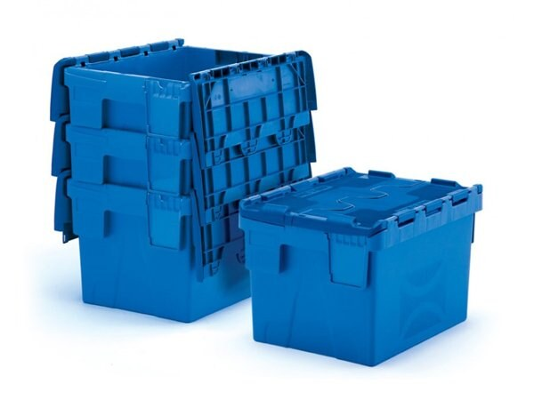
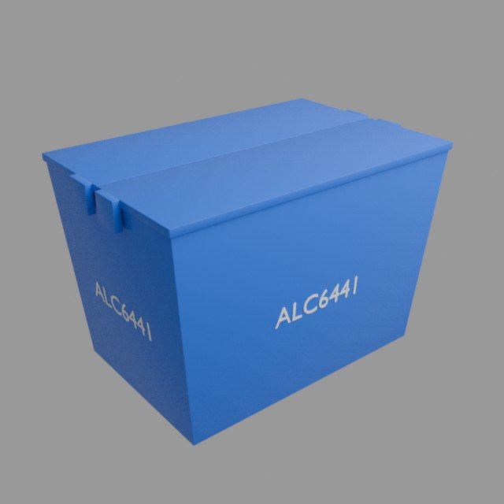

# Attached-Lid Containers (ACLs)

If you buy one box format specifically **for moving** rather than for storage, buy
this one.

An **ACL** — *attached container lid*, also written ALC (*attached-lid container*) —
is a Euro-footprint crate whose lid is moulded onto the box on hinges instead of
being a separate part. The trade also calls them **distribution totes** or
**swan-neck crates**, and affectionately **"turtles"** — the two lid halves sitting
up over a tapered shell do look the part. That nickname is not just a joke: they're
listed as 乌龟箱 ("turtle box") on Chinese marketplaces, which is worth knowing if
you ever source from Alibaba.

*The two states that make an ACL an ACL. **Left:** empties nested inside one another,
lids open — the tapered shell is what allows it. **Right:** closed and stackable, the
two hinged lid halves meeting on the centre line with the hasp tabs at the front edge.*

## What's different about them

| Feature | What it does |
|---------|--------------|
| **Two-part hinged lid** | Meets on the centre line, interlocking along the join. Opens and closes one-handed, with no lid to put down. |
| **Hasp tabs at the front edge** | Take a cable tie or a numbered security seal, so "sealed" means "packed and checked". |
| **Tapered walls with rib bands** | Empties **nest inside each other** with the lids open, and stack squarely when closed and loaded. |
| **Same 600 × 400 footprint** | Interchangeable with everything else in the system — same shelf, same dolly, same pallet layer. |

That taper is the one thing to internalise: **an ACL is not a scaled-up Eurobox.**
A straight-wall Eurobox stacks by nesting its base into the rim below; an ACL stacks
on its closed lid and nests only when empty and open. The two behave differently and
are worth thinking about separately.

## Why they're the moving box

1. **The lid cannot get lost or mismatched.** With sixty boxes in play, loose lids
   are a logistics problem of their own — they get separated from their box, stacked
   somewhere else, packed in the wrong load. An attached lid removes the problem
   entirely.
2. **One-handed close.** You are always holding something on moving day. Flipping
   two hinged halves shut needs no free surface and no second hand.
3. **Sealable.** A cable tie through the hasp tabs is a visible "this one is done"
   marker, and it survives a van, a lift, and a stairwell.
4. **Empties nest.** The dead leg of a move — before you pack, and after you unpack —
   is where straight-wall crates cost you the most space. Nested ACLs take a fraction
   of the volume of the same count of Euroboxes.
5. **Deep.** At 41 cm they swallow the awkward stuff: bedding, coats, kitchen
   miscellany. (Deep also means heavy when full — see the load note below.)

## The trick that makes them worth owning: same footprint, both ways

Because ACLs and Euroboxes share the **600 × 400 mm** footprint, the two formats are
**interchangeable at any point in the cycle**:

- **Before and during the move** — pack into ACLs. They seal, they nest, they don't
  shed lids.
- **After the move** — decant into Euroboxes for shelved storage, where the
  straight walls use the shelf volume better and the locking lid comes off cleanly.
- **And back again** — next move, decant the other way.

Nothing has to be repacked to a different size, nothing has to be re-measured against
the shelving, and a mixed column of ACLs and Euroboxes still rides the same dolly and
still tiles four-to-a-layer on a Euro pallet. This is the interoperability argument
from [Interoperability](interoperability.md) paying out in the most practical way it
can.

**Practical consequence:** you don't need an ACL for every box. Buy a handful — enough
for the awkward, bulky, last-week-of-the-move loads — and let the Euroboxes do the
permanent storage.

## Second life: the rolling trash cart

Ours doesn't sit idle between moves. One ACL on a platform trolley, with a bin liner
draped over the rim and the lid closed on top of it, is a **rolling trash cart** —
the cost-conservative stand-in for a proper cleaning trolley. During unboxing you
throw packaging straight in, wheel it to the bins, and empty it. See
[Moving Equipment](moving-equipment.md).

When the next move comes, take the liner out and it goes back to being a moving box.

## Sizes

The Euro-footprint ACL range runs in heights, all on 600 × 400 mm. Israeli supplier
catalogue (YosiBox, the T-series) as a representative sample:

| Model | Size (cm) | Note |
|-------|-----------|------|
| T-3423 | 40 × 30 × 24 | Half-Euro footprint |
| T-4627 | 60 × 40 × 27 | Shallow |
| T-4631 | 60 × 40 × 31.5 | |
| T-4636 | 60 × 40 × 36.5 | |
| **T-4641** | **60 × 40 × 41.5** | The one in this system |
| T-4646 | 60 × 40 × 46.5 | Tallest |

Numbering conventions differ by manufacturer, but the footprint doesn't — check the
footprint, not the model code.

*The 60 × 40 × 41.5 as a true-scale GLB, from
[storage-box-3d-models](https://github.com/danielrosehill/storage-box-3d-models) —
useful for laying out a pallet or a shelf bay before buying anything. The same models
back the 3D section of the
[Eurobox calculator](https://danielrosehill.github.io/storage-container-calculator/).*

## When *not* to reach for one

- **Long-term shelved storage.** The taper wastes cubic volume against a straight
  wall, and the lid you can never remove is in the way every time you reach in.
  Euroboxes win here.
- **Weight.** A 41 cm box filled with books is past what you want to lift from the
  floor. Depth is a licence to overload — see
  [Pallets, Elevators & Biomechanics](pallets-elevators-biomechanics.md).
- **Shelf-pitch planning.** At ~41 cm plus clearance, an ACL wants a much taller
  shelf bay than a 23 cm Eurobox. Plan the pitch before you buy — see
  [Industrial Shelving](industrial-shelving.md).

## Related

- [← Contents](README.md) · [Euroboxes](euroboxes.md) · [Moving Equipment](moving-equipment.md) ·
  [Industrial Shelving](industrial-shelving.md) · [Interoperability](interoperability.md)
