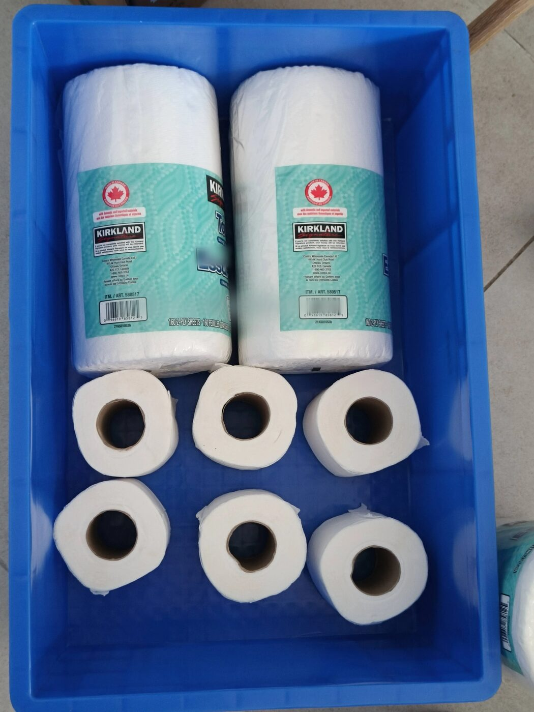

# Consumables & Inserts

Next frontier: using Euroboxes as a **home pantry / supply system** for consumables,
not just for owned items.

## The idea

Route bulk household consumables through the same grid of stacking boxes:

- Kitchen roll / paper towels
- Toilet paper
- Toothpaste and other bathroom consumables
- Anything bought in bulk and used on a schedule

Result: defined, visible, restockable homes on-grid. See levels at a glance, buy in
bulk without the bulk becoming clutter.

*Bulk consumables on-grid: levels visible at a glance, restockable without the bulk becoming clutter.*

## The key: inserts

A bare box is a good box but a mediocre organizer. Inserts/dividers make consumables
work. Two kinds:

| Type | What it is | Best for |
|------|------------|----------|
| **Ready-made inserts** | Trays/cups/divider kits sized to standard Euro footprints | Standardized items where a stock size fits |
| **Cuttable inserts** | Foam or corrugated sheet cut to fit | Odd shapes, custom compartments, fragile items |

Standardized footprints mean **ready-made inserts drop straight in** — a payoff of
staying on-grid. Cuttable foam/board covers the rest.

## To do

- [ ] Identify ready-made insert systems for 600×400 and 400×300 footprints.
- [ ] Work out a cuttable-insert approach for odd consumables.
- [ ] Document a starter "pantry wall" layout once built.
- [ ] Photograph it (see [`../photos/`](../photos/)).

## Related

- [← Contents](README.md) · [Euroboxes](euroboxes.md) · [Sourcing](sourcing.md)
