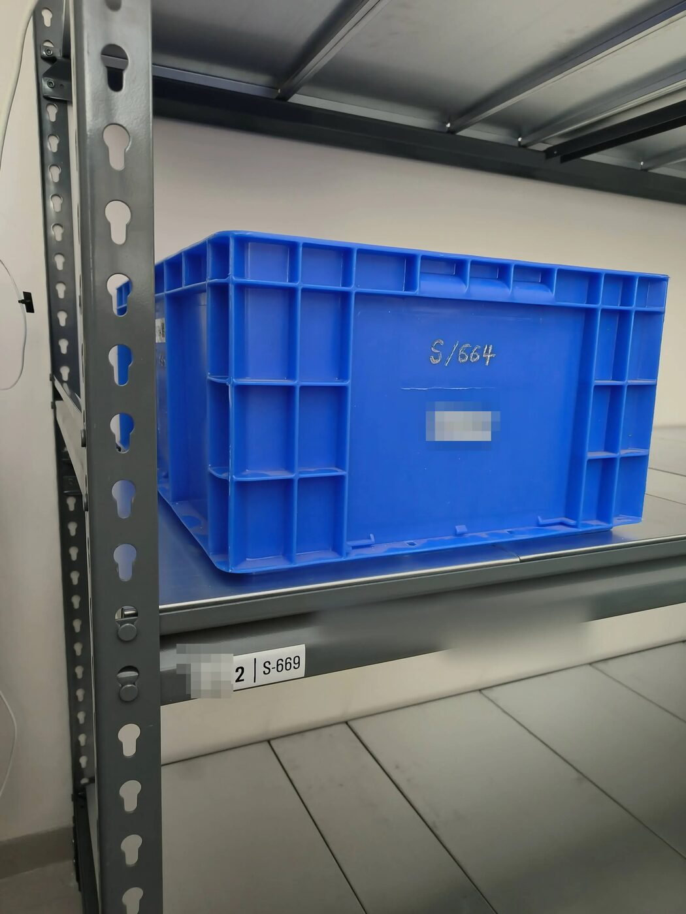

# Cost of Ownership: IKEA vs. Industrial

Industrial boxes cost more up front. The case for them is **total cost of ownership**
— what a box actually costs you per year of service, once you account for how long it
survives — plus durability advantages that don't show up on a price tag at all.

Here are the workings, with real prices.

> Prices are real, mid-2026, VAT included: **IKEA Israel** (ikea.co.il) and
> **[YosiBox](http://yosibox.com/)** (industrial, incl. VAT). Lifespans are estimates —
> the IKEA figure is my own experience (see below). Capacities don't match exactly;
> the point is the *per-year* cost and the durability, not a like-for-like volume.

## The sticker prices

**IKEA SAMLA** (thin polypropylene, consumer):

| Size | Box | With lid |
|------|-----|----------|
| 11 L (39×28×14) | ₪15 | ₪22 |
| 22 L (39×28×28) | ₪22 | ~₪34 |
| 45 L (56×39×28) | ₪35 | ₪47 (plain) / ₪65 (clip-lock) |
| 130 L (78×56×43) | ₪95 | ₪127 |

**YosiBox Euro** (industrial HDPE), lids ₪23:

| Model | Size | Box | + lid |
|-------|------|-----|-------|
| G-3417 | 40×30×17.5 | ₪98 | ₪121 |
| G-3423 | 40×30×23 | ₪106 | ₪129 |
| G-4634 | 60×40×34 | ₪153 | ₪176 |

So a large industrial box+lid (**₪176**) is ~**2.7×** the price of a comparable
SAMLA+lid (**₪65**). That's the number people stop at. Here's why it's the wrong number.

## The lifespan (the part nobody prices in)

- **IKEA SAMLA:** mine **cracked and failed after ~4 years** of ordinary use — thin PP,
  brittle at the rim, and it degrades under Israeli sun (see UV below). *4-year life.*
- **YosiBox Euro (HDPE):** warehouse-grade, built for years of industrial abuse and
  UV-stable. A conservative home lifespan is **15+ years**; realistically closer to
  "buy once." *Use 15 years.*

## Total cost of ownership — a 20-year horizon

Large general-purpose box, box + lid:

| | IKEA SAMLA 45 L | YosiBox 60×40×34 |
|---|---|---|
| Sticker price | ₪65 | ₪176 |
| Lifespan | 4 years | 15 years |
| **Cost per year** | **₪16.3** | **₪11.7** |
| Purchases over 20 yr | 5 (rebuy every 4 yr) | ~1.3 |
| **20-year total** | **₪325** | **₪235** |
| Boxes sent to landfill | 4 | 0 |

**The 2.7×-pricier box is ~28% cheaper over 20 years** — and if the Eurobox lasts the
20 years (very plausible), it's ₪176 vs ₪325, i.e. **~46% cheaper**.

**Break-even** lands around **year 8–11**: by the third SAMLA (₪195) you've already
paid more than one Eurobox (₪176), and everything after that is pure saving.

### Not counted above (all favour the Eurobox)
- **Moving-box savings.** The Eurobox *is* the moving box — no cardboard to buy/rent
  each move. In a market where you move every ~3 years, that recurs 6–7 times over the
  horizon.
- **Palletizing / interlocking** (faster, cheaper moves — see
  [Pallets, Elevators & Biomechanics](pallets-elevators-biomechanics.md)).

## Two advantages that never show up on the price tag

### Sustainability: buy it once
Yes, it's plastic. But it's **HDPE — a thicker, tougher, more durable plastic** than the
thin PP of consumer bins. If you're going to spend a finite, petrochemical resource, the
*sustainable* move is to buy the best quality **once** and keep it for a decade or two —
not cycle cheap bins into landfill every four years. Fewer units made, fewer thrown away.

### UV resistance (critical in Israel)
Israel's UV is punishing. Anything stored near a window — let alone outdoors — degrades
fast, and low-grade plastics go brittle and chalky within a season or two. In our
experience even name-brand consumer plastics (e.g. Keter) simply haven't held up.
Industrial HDPE Euroboxes are UV-stable: I've stored them **outside, uncovered, without
hesitation**, and they've held. In this climate that alone can justify the price gap.

*Warehouse-grade HDPE: UV-stable and built to outlast several cycles of consumer bins.*

## Bottom line

| | IKEA SAMLA | YosiBox Euro |
|---|---|---|
| Up front | Cheaper | 2.7× |
| Over 20 years | **₪325** | **₪235** |
| Landfill | 4 boxes | 0 |
| Doubles as moving box | No | Yes |
| Interlocks / palletizes | No | Yes |
| UV / outdoor | Poor | Excellent |

Pay ~2.7× once, or pay less-per-year while also getting a box that moves your house,
survives the sun, and outlives four of its cheaper rivals.

## Related
- [Euroboxes](euroboxes.md) · [Sourcing](sourcing.md)
