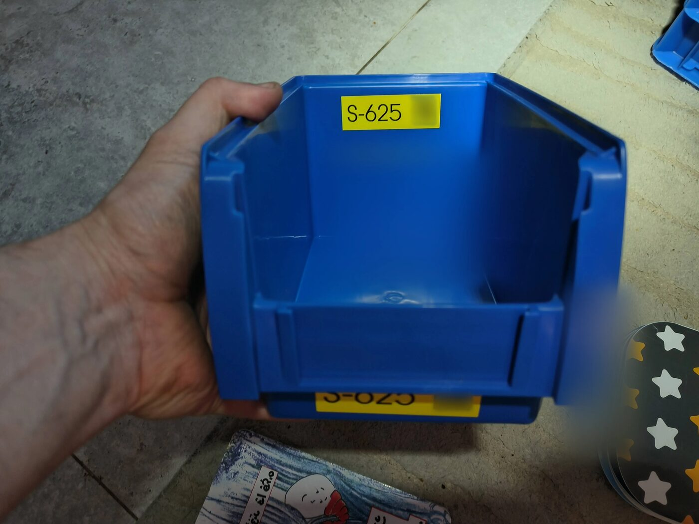
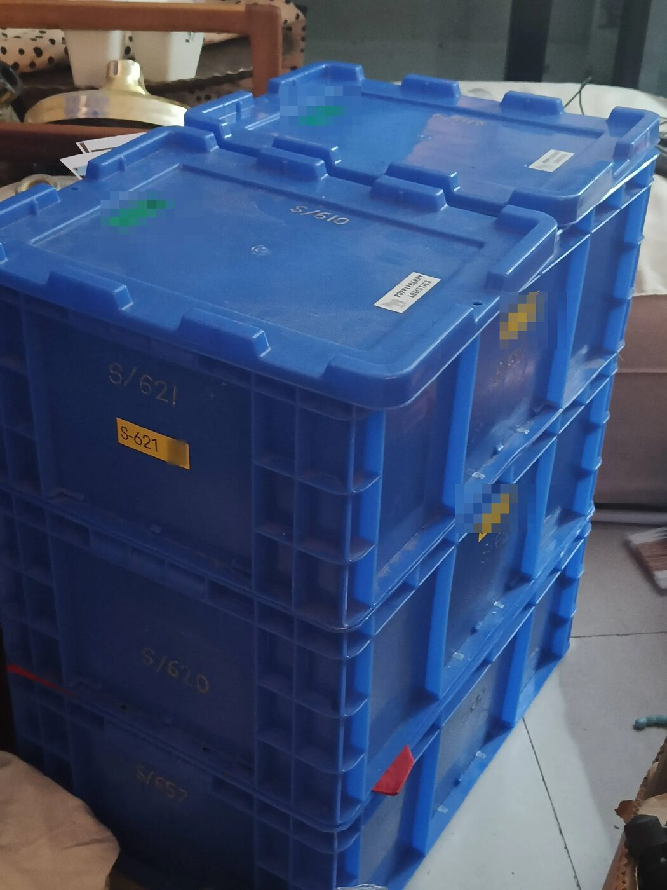

# Euroboxes

The backbone of the system.

## What they are

**Euro containers** (Eurobox / stacking container / "KLT") — industrial storage
boxes built on a standardized **600 × 400 mm** footprint and its clean divisions.

- **Stack** stable — base nests onto the rim below.
- **Interlock** — a column behaves as one unit.
- **Locking lids** clip on and stay on.
- Built for years of warehouse use, not one house move.
- Standardized footprint → fits matching shelving and tiles onto a Euro pallet with
  zero wasted space (see [Interoperability](interoperability.md)).

*Bases nest onto the rim below, so a stack behaves as one rigid column.*

## The three sizes I use

| Size (cm) | Footprint | Role |
|-----------|-----------|------|
| **60 × 40 × 23** | Euro (600×400) | Everyday items / shallow storage — daily driver |
| **60 × 40 × 34** | Euro (600×400) | Deeper loads — whole toolsets |
| **40 × 30 × 17** | Half-Euro (400×300) | Small parts, tool-cabinet-drawer contents |

Two footprints, three heights. The 40×30 boxes sit two-across on a 60×40, so even
the small ones stay on-grid.

*Locking lids clip on and stay on; every box carries an inventory label (see [Where's My Box](wheres-my-box.md)).*

## Why they beat cardboard: double duty

Bought **before** the move, so they serve twice:

1. **Moving boxes** — sturdier than cardboard, stack on a dolly, don't collapse when
   damp or stacked high.
2. **Permanent storage** — the box *is* the storage. Carry in, set on shelf, done.
   Nothing to unpack into.

Cardboard = recurring expense you throw away. Euroboxes = an asset that makes every
future move cheaper (the "boxes" already exist, already packed).

## Related

- [Consumables & Inserts](consumables-and-inserts.md)
- [Picking & Sorting Bins](picking-and-sorting-bins.md)
- [Where's My Box](wheres-my-box.md)
