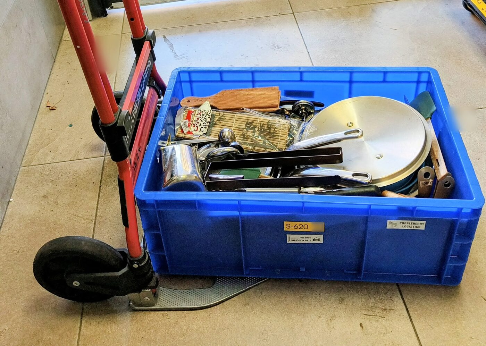

# Gastronorm

Same principle as Euroboxes, different room: an industrial standard that works well
at home if you know it exists.

## What it is

**Gastronorm (GN)** — the European standard for food-service container sizes (the
pans in every professional kitchen). A modular grid: a base size and clean fractions
(GN 1/1, 1/2, 1/3, 1/6…) that nest, stack, and share lids, counters, and trolleys.

## Practical notes

- Sourced from **kitchen-supply shops**, not IKEA/supermarkets — better made,
  standardized, stackable, endlessly replaceable.
- Uses at home: food transport (potlucks), leftovers, bulk storage.
- Fully normalized in daily use — the "restaurant equipment" framing disappears.

*The same standards instinct in the kitchen — pans and kit moved in the same interlocking boxes.*

## Why it's in this repo

Proof the "warehouse apartment" instinct generalizes. The habit: when you need to
store/carry/organize *anything*, ask what professionals in that field standardized
on, then buy that. The consumer version is usually a worse, non-standard imitation
of a standard you're also allowed to buy.

- Kitchen → **Gastronorm**
- Storage & moving → **Euroboxes & pallets**

## Related

- [← Contents](README.md) · [Euroboxes](euroboxes.md) · [Interoperability](interoperability.md)
