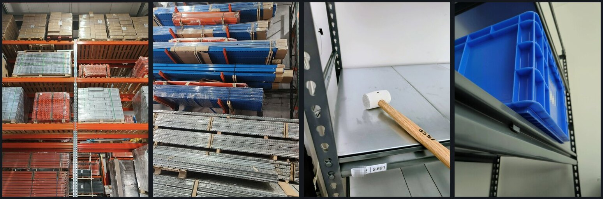
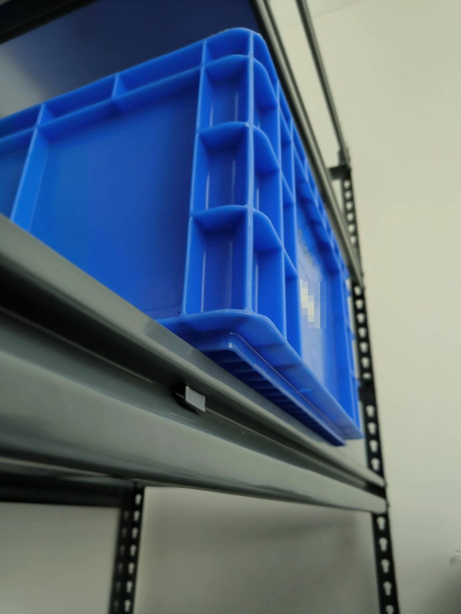
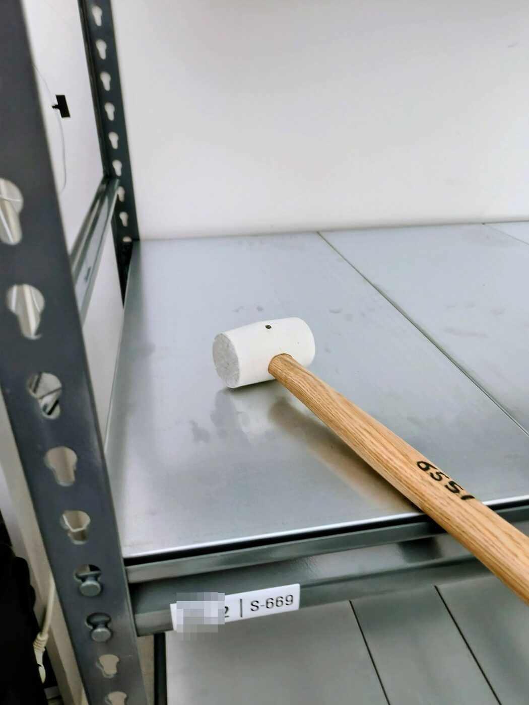
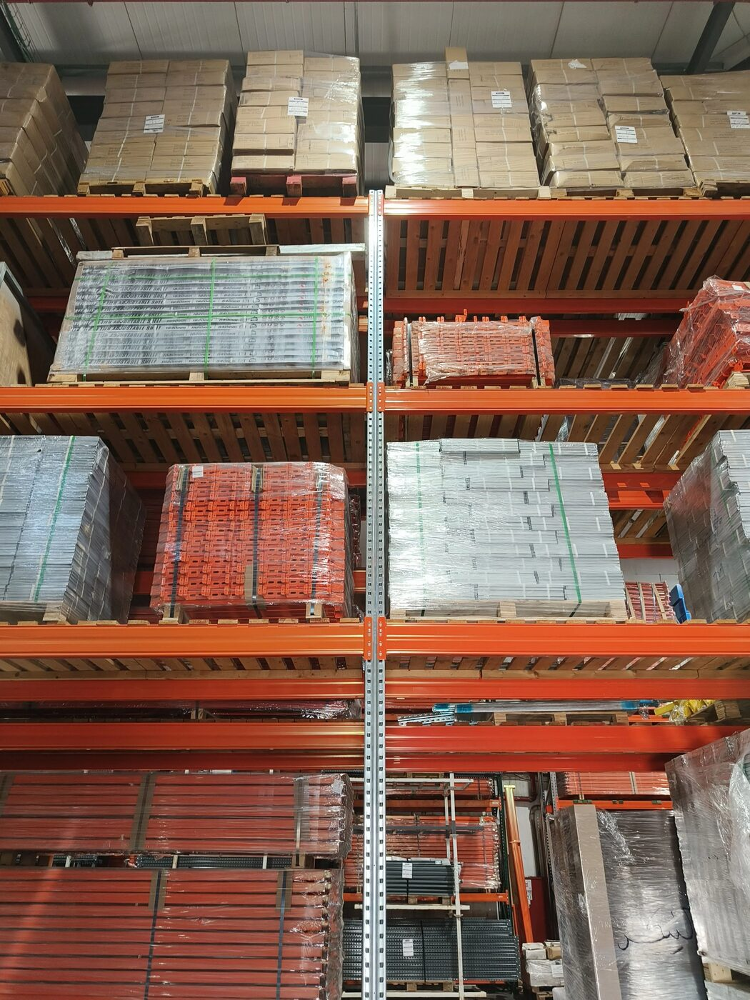

# Industrial Shelving

Boxes are half the system. The other half is what you put them on — and this is the
part most people get wrong, because consumer shelving is sized for *objects* while
industrial shelving is sized for *containers*.

Get the shelving right and the storage wall becomes one coordinated system: every box
face flush to the aisle, every shelf full, nothing perched or wedged. Get it wrong and
you own very good boxes sitting badly on furniture.

*Left to right: a shelving supplier's racking; flat-packed uprights, beams and steel
decks on pallets; assembly with a rubber mallet — no bolts, no tools; a 600 × 400
Eurobox landing on a 600 mm-deep shelf with its full footprint supported.*

## The one number that matters: depth

**Industrial shelving is standardised to the same depths as the boxes** — very
commonly **600 mm**, with 300, 400 and 500 mm variants. That's not a coincidence.
The shelving exists so a Eurobox sits on it with its **full footprint supported** and
its face **flush to the aisle**.

| Shelf depth | Box orientation | Result |
|-------------|-----------------|--------|
| **600 mm** | 600 mm side front-to-back | 400 mm face to the aisle; full support; deepest use of the wall |
| **400 mm** | 400 mm side front-to-back | 600 mm face to the aisle; more labels visible per metre |
| 300 mm | 40 × 30 boxes only | Small-parts wall |

*What "matched depth" looks like: the box lands on the deck with its whole footprint
carried and its face square to the aisle. Nothing overhangs, nothing is wedged.*

Consumer shelving lands on none of these — 28 cm, 35 cm, 45 cm depths are typical,
so a 600 × 400 box overhangs, hangs off the front, or leaves a dead strip at the back.
That dead strip is what you're paying rent on.

## And the second number: beam length

Beam (shelf) widths cluster around **900, 1200 and 1800 mm**. On the 600 × 400 grid:

| Bay width | Boxes across (400 mm face) | Boxes across (600 mm face) |
|-----------|---------------------------|---------------------------|
| 900 mm | 2 + 100 mm slack | 1 + 300 mm slack |
| **1200 mm** | **3, exactly** | 2, exactly |
| 1800 mm | 4 + 200 mm slack | 3, exactly |

A **1200 × 600 mm bay is exactly half a Euro pallet footprint** and takes exactly
three 600 × 400 boxes face-on. It is the single most useful bay size for this system,
and it is also the sharpest edge: *exactly* three means **zero finger clearance**.
Either accept that you'll be tipping boxes out rather than lifting them straight up,
or run two boxes plus a working gap. Measure your own boxes — external dimensions vary
by a few millimetres between manufacturers, and 3 × 402 mm does not fit in 1200 mm.

## Boltless / keyhole shelving

The type worth buying for a rented flat is **boltless** (a.k.a. rivet or keyhole
shelving):

- **Uprights** carry **keyhole slots running the full height**, typically at a 25–50
  mm pitch.
- **Beams** have hooked studs that drop into a keyhole and lock by being **tapped
  down with a rubber mallet**. No bolts, no nuts, no spanner.
- **Steel deck panels** drop onto the beams.

*The whole toolkit is a rubber mallet. Beams hook into the keyhole slots and lock
downward; the steel deck panels drop in on top.*

Why boltless matters here specifically: **it comes apart as fast as it went together
and travels with you.** For anyone moving involuntarily every couple of years — the
premise of [The Why](the-why.md) — shelving that flat-packs into a car is not a
convenience, it's the difference between an asset and something you abandon in the
old flat.

**Adjustability is the other payoff.** Because the keyholes run the full height, you
set the **shelf pitch to the box height**, not to whatever the manufacturer decided:

| Box | Pitch to set |
|-----|--------------|
| 60 × 40 × 12 | ~17 cm |
| 60 × 40 × 23 | ~28 cm |
| 60 × 40 × 34 | ~40 cm |
| ACL 60 × 40 × 41 | ~48 cm |

Rule of thumb: **box height + 4–5 cm** for hand clearance. If you plan to lift boxes
straight out, add more; if you slide them, less. Plan the whole unit before you build
it — moving a beam is a five-minute job, but only if the shelf above is empty.

## Decking: steel, mesh or chipboard

| Deck | Verdict |
|------|---------|
| **Steel panels** | What you want. Flat, rigid, won't sag under a full box, wipe clean. |
| **Wire mesh** | Fine, and lets light and sprinkler flow through — but small items fall through and dust doesn't stop at the shelf. |
| **Chipboard / MDF** | Avoid. Sags under sustained load, swells if anything gets damp, and is the reason most cheap "garage shelving" ends up bowed. |

## Load

Read the label on the specific unit; ratings vary widely by duty class and are quoted
as **UDL — uniformly distributed load** per shelf, which is a different (and much
kinder) number than a point load. Two things that matter more than the sticker in a
home setting:

- **The floor and the fixing, not the shelf.** A tall unit full of dense boxes is
  top-heavy. **Anchor it to the wall.** This is not optional if there are children in
  the flat, and it is what stops a unit walking when you drag a loaded box off the
  top shelf.
- **Heavy low, light high.** Books, tools, tinned goods on the bottom two shelves;
  bedding, packaging and empties at head height. This is also the biomechanics
  argument — see [Pallets, Elevators & Biomechanics](pallets-elevators-biomechanics.md).

## The side face is storage too

The outward-facing **side** of a shelving unit is a full-height vertical surface most
people leave blank. The keyhole slots run the full height of *both* uprights, so it's
already a mounting grid.

The standard warehouse pattern is a **louvred panel bolted through the keyholes**,
with open-front [picking bins](picking-and-sorting-bins.md) hung on the louvres — the
bins have a hooked lip moulded into the back exactly for this. Nobody screws pick bins
to bare uprights; it's fiddly, non-adjustable and weak.

A build that works:

- **Top half — louvred panel** carrying pick bins. A 60 cm-wide panel spans the side
  face of a 60 cm-deep unit exactly, and bolts through the keyholes with M6/M8 bolts
  and fender washers.
- **Bottom half — pegboard** for tools and flat items. IKEA **SKÅDIS** is the cheap
  route, with one catch worth knowing: every SKÅDIS board is **56 cm** on one side,
  and on our units the keyhole centres are **58 cm** apart across the 60 cm face — so
  the bolt holes fall *outside* the board. Fix two vertical battens to the keyholes at
  58 cm and screw the board to those. That's the better build anyway, since SKÅDIS
  needs 15–20 mm of standoff for its hooks.
- **Measure your own keyhole spacing before ordering anything.** 58 cm is what our
  60 cm units happen to use (slots inset ~1 cm from each edge); it is not a standard.

Depth clearance is the constraint to check: a deep pick bin (45 cm) hung on a panel
projects ~46–48 cm from the side of the unit and nearly doubles the footprint on that
side. Hang the deep bins low, or split them across two faces.

## Buying

1. **Search in trade terms** — "boltless shelving", "rivet shelving", "מידוף
   תעשייתי" — not "storage rack". You want a shelving/racking supplier, not a DIY
   shed. Same posture as [Sourcing](sourcing.md): these are B2B outfits, and most
   will sell to an individual if you ask plainly.
2. **Specify depth first**, then beam length, then height. Depth is the one you can't
   fix later.
3. **Ask what the decks are** — "steel panel" is a different product from "chipboard
   on a steel frame" at a similar price.
4. **Ask about the keyhole pitch and spacing** if you plan to use the side face.
5. **Check what it flat-packs to.** Beams are 90–180 cm long and uprights run
   180–250 cm. They do not fit in a Eurobox and they may not fit in your car — the
   one component of this system that doesn't play by the 600 × 400 rules. Budget for
   delivery, or measure the car before the shop measures it for you.
6. **Buy one bay more than you need.** Adding a bay later means matching the exact
   upright profile; the same supplier a year on may have changed range.

**In Israel:** we bought from **[madafim.co.il](https://madafim.co.il)** (60 cm-deep
boltless units, keyhole uprights), alongside the Euroboxes from
[YosiBox](http://yosibox.com/). Shelving suppliers and box suppliers are usually
different businesses — expect two orders and two deliveries.

*Where it comes from: a shelving supplier's own racking, loaded with pallets of
flat-packed uprights, beams and decks. The keyhole upright in the foreground is the
part that makes the whole thing tool-free.*

## Other industrial storage worth knowing

Shelving is the backbone, but the same B2B catalogues carry the rest of the wall:

| Kit | What it's for |
|-----|---------------|
| **Pull-out drawer units** | Drop into the 60 cm module; give you drawer access without giving up the grid. We run nine, with a four-drawer unit going in for USB cables. |
| **Louvred panels / louvre strips** | Side-face and wall mounting for pick bins (above). |
| **Pallet racking** | The heavy-duty tier — beams on uprights sized for a loaded Euro pallet. Overkill for a flat, but it's what the supplier's own warehouse is built from, and worth recognising. |
| **Bin cups / dividers** | Sub-divide a Eurobox on the shelf without changing the footprint — see [Consumables & Inserts](consumables-and-inserts.md). |
| **Mobile / roll-out shelving** | Castored bays. Tempting; be honest about whether the floor is level. |

## The short version

**Buy shelving in the depth that matches your box footprint.** Buy it **boltless**, so
it comes to the next flat. Set the **pitch to your box heights**, not to the
manufacturer's guess. **Anchor it to the wall.** And use the **side face** — it's the
cheapest square metre in the room.

## Related

- [← Contents](README.md) · [Euroboxes](euroboxes.md) · [Interoperability](interoperability.md) ·
  [Picking & Sorting Bins](picking-and-sorting-bins.md) · [Sourcing](sourcing.md)
