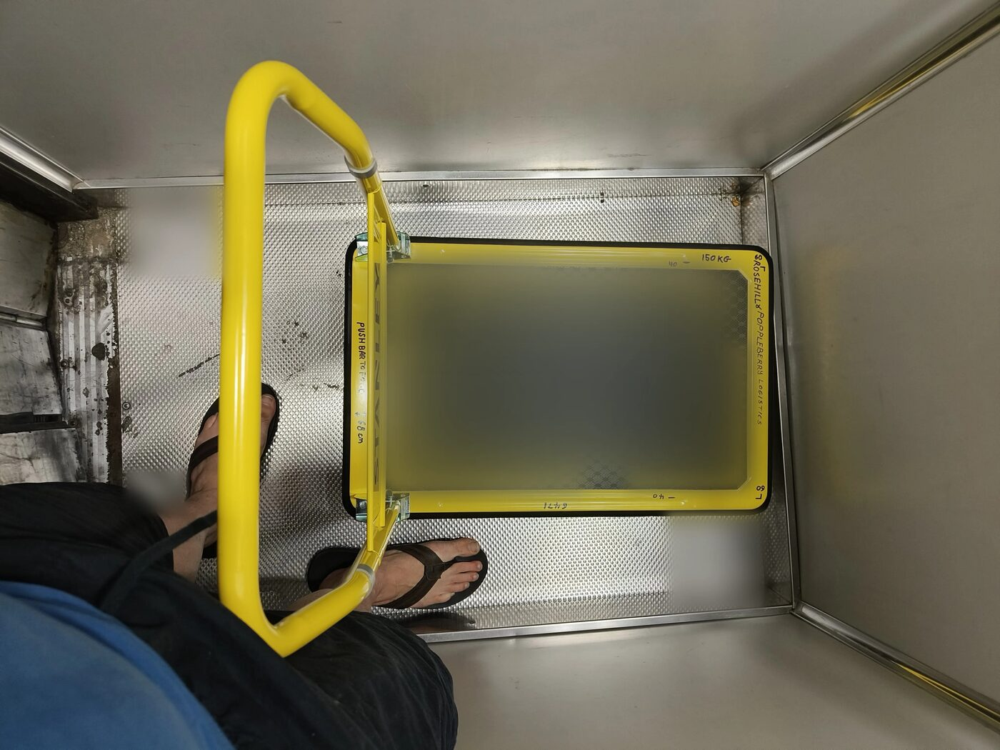
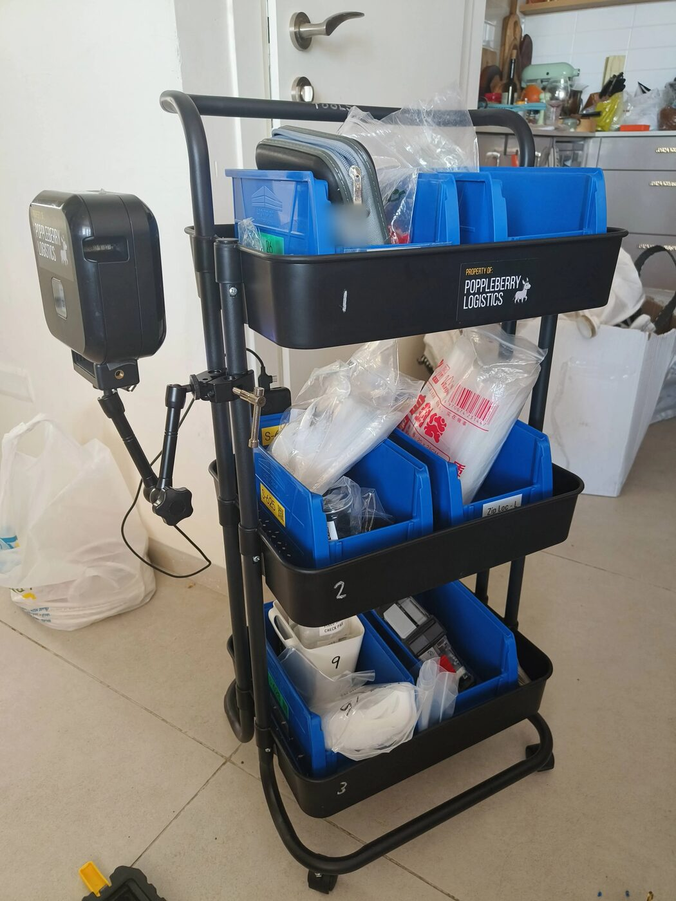

# Moving Equipment

The gear that lets one person move a household without a crew. Cost of all of it is
a fraction of one professional move.

## Kit list

| Item | Function | Notes |
|------|----------|-------|
| **Stanley Dolly** (basic 4-wheel) | Roll ~8 interlocked Euroboxes at once | Interlocking is what keeps the stack from sliding apart |
| **Platform trolley / commercial dolly** | Flat deck, high load rating | Workhorse of a DIY move |
| **Ratchet straps** | Turn a stack into one rigid load | Tilt/wheel/maneuver without babysitting the top box |
| **Pallet jack** (wishlist) | Move a loaded pallet | See [Pallets, Elevators & Biomechanics](pallets-elevators-biomechanics.md) |

*A basic hand truck moves an interlocked column at once; the interlock keeps it from sliding apart.*

## Improvised rolling trash cart

Cost-conservative stand-in for a cleaning trolley:

- Big **ACL box (60 × 40 × 41 cm)** on the **platform trolley** → rolling trash can.
  Bin liner over the rim, hinged lid closed on top of it. See
  [Attached-Lid Containers](attached-lid-containers.md).
- During unboxing: throw packaging/junk straight in, wheel it, empty it.
- Between moves that's all it does — pull the liner and it's a moving box again.
- Wishlist: dedicated **cleaning trolley / bin on wheels** to replace it.

*An improvised rolling cart for the unboxing phase — junk in, wheel it, empty it.*

## Why it matters

A trolley + dolly + straps cost far less than one full-service move. If you're
moving repeatedly, the gear pays for itself the first time and is free every time
after.

## Related

- [← Contents](README.md) · [Attached-Lid Containers](attached-lid-containers.md) · [Pallets, Elevators & Biomechanics](pallets-elevators-biomechanics.md)
