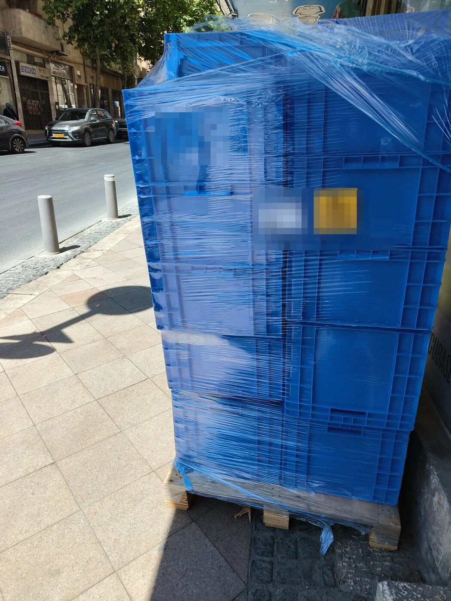
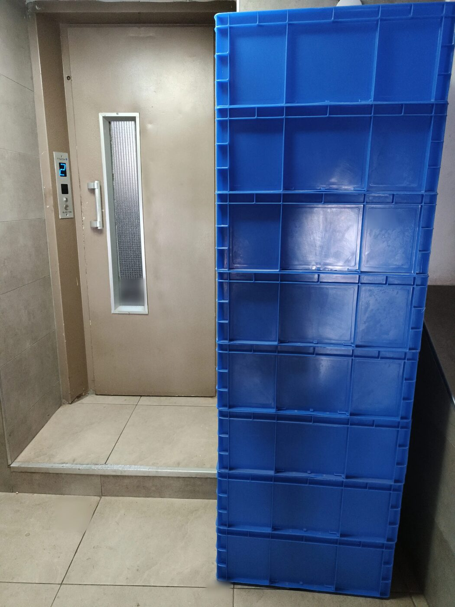

# Pallets, Elevators & Biomechanics

Where the home system meets actual logistics. Three things people outside the trade
rarely know.

## 1. Euro pallets close the loop

- **Euro pallet: 120 × 80 cm.** Holds exactly **4 × (60 × 40) footprints per layer**
  (2 × 2) — Euroboxes tile onto it with no wasted space.
- The pallet is the **move-out unit**: load a column of interlocked boxes, strap,
  move the whole thing with a **pallet jack**.

*The move-out unit: a column of interlocked boxes strapped to a Euro pallet, ready for a jack.*

## 2. Elevator dimensions dominate move difficulty

- Old building: elevator ~**56 cm** deep — barely room to stand. This single fact,
  more than anything else, made both the DIY and the professional portions of the
  move dramatically slower. Everything had to be broken down or taken by stairs.
- New building: proper service elevator → the same move was comfortable.
- **Takeaway:** when choosing an apartment (or booking a move), the elevator matters
  more than most people weight it. Check the depth.

*Elevator depth decides everything: a proper service lift takes a full column; a 56 cm cab forces the stairs.*

## 3. Moving effort is non-linear (the palletizing case)

> Moving one fully loaded pallet with a jack is **not much harder** than moving two
> stacks of Euroboxes side by side.

| Method | Effort scaling | Load-bearer |
|--------|----------------|-------------|
| Carrying boxes one by one | **Linear** in box count | Your body |
| Rolling a loaded pallet | **~Flat** | The wheels |

Once anything is on wheels, the marginal cost of moving *more* is small — the jack
takes the weight, you steer. This is the whole biomechanical argument for
palletizing at home: standardized boxes → tile onto a standardized pallet → moved by
a standardized jack. Each standard hands off cleanly to the next.

## Related

- [Moving Equipment](moving-equipment.md) · [The Shipping-Container Thesis](shipping-container-thesis.md)
