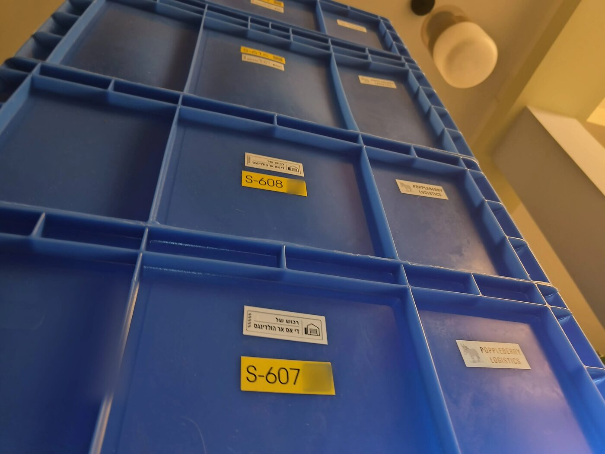
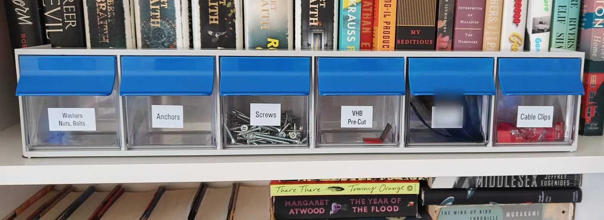

# Picking & Sorting Bins

Euroboxes handle storage. A second container family handles **fast, open access** to
frequently-used items.

## Container-to-need matrix

| Need | Container | Notes |
|------|-----------|-------|
| Deep, sealed, stacked storage | Eurobox + locking lid | Long-term |
| Frequent grab-access | Picking bin (open front) | No lid to lift |
| Sorting many small things | Sorting bin (compartments) | Parts, hardware |

The common mistake is using one type for everything. Sealed boxes for daily items
are painful; open bins for long-term storage collect dust and topple. **Match the
container to how often you touch the contents.**

## Picking bins

Open-front ("louvre") bins — front cut away, shaped to stack on a slope so the
opening faces you. Warehouse pick-face standard.

At home, during unboxing: fast access to the stuff you reach for constantly —
screwdrivers, tape, markers, box cutters, chargers. I also run some lidless **40×30×17
Euroboxes** in the same role.

*Open-front "louvre" bin — the opening faces you, no lid to lift.*

## Sorting bins

Same ecosystem, aimed at organizing: many small compartments for separating parts
and hardware.

*Labelled bins keep small hardware — screws, anchors, cable clips — sorted and grab-accessible.*

## Where to hang them

Picking bins have a hooked lip moulded into the back, made to hang on a **louvred
panel**. The best surface for that panel in a small flat is the otherwise-blank
**side face of a shelving unit** — a full-height vertical grid you already own. See
[Industrial Shelving](industrial-shelving.md#the-side-face-is-storage-too).

## Related

- [← Contents](README.md) · [Euroboxes](euroboxes.md) · [Industrial Shelving](industrial-shelving.md) · [Sourcing](sourcing.md)
