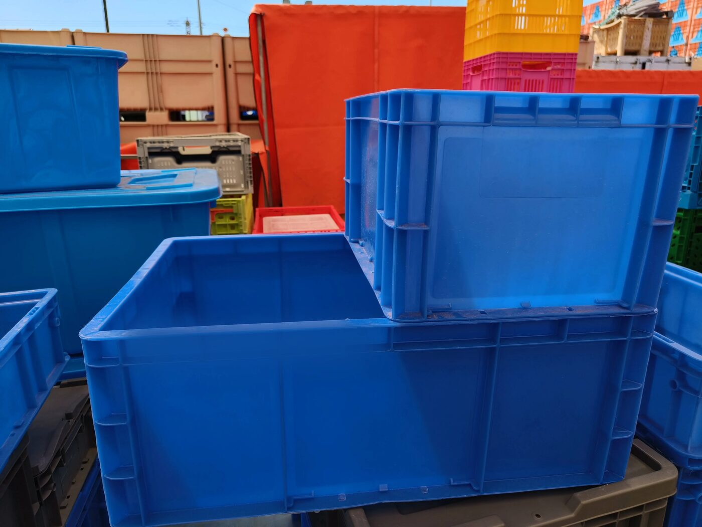

# The Shipping-Container Thesis

The reason this approach feels like more than tidiness: the standards **nest**. Each
unit is a clean division of the one above it, all the way up to intermodal shipping.

## The chain of standards

| Unit | Size | Divides into the one above |
|------|------|----------------------------|
| **Eurobox** | 600 × 400 mm footprint | 4 per Euro-pallet layer |
| **Euro pallet** | 1200 × 800 mm | Fits standard container floors |
| **ISO shipping container** | 20/40 ft (ISO 668) | The intermodal unit — ship, rail, truck |

Pack your belongings into Euroboxes and they are already in the base module of a
system that scales, unbroken, to international freight. Nothing needs re-packing to
move up a level — the box goes on the pallet, the pallet goes in the container.

*The same nesting logic industry runs on, at yard scale — boxes on pallets, pallets to containers.*

## Why it's practically relevant (not just neat)

- **Cross-country moves become tractable.** Belongings already in
  pallet-and-container-ready units are far cheaper and faster to ship internationally
  than a house full of loose furniture and cardboard.
- **A real contingency plan.** After repeated involuntary displacement (see
  [The Why](the-why.md)), having your life already stored in the base unit of global
  logistics is a concrete option, not a fantasy: if leaving the country ever became
  necessary, the belongings are pre-staged for it.
- **Optionality has value even unused.** Knowing the exit is mechanically simple is
  worth something on its own.

## The one-line version

Standardize at the smallest unit (the box) and you inherit every larger standard for
free — up to and including the shipping container that moves things between countries.

## Related

- [Interoperability](interoperability.md) · [Pallets, Elevators & Biomechanics](pallets-elevators-biomechanics.md)
