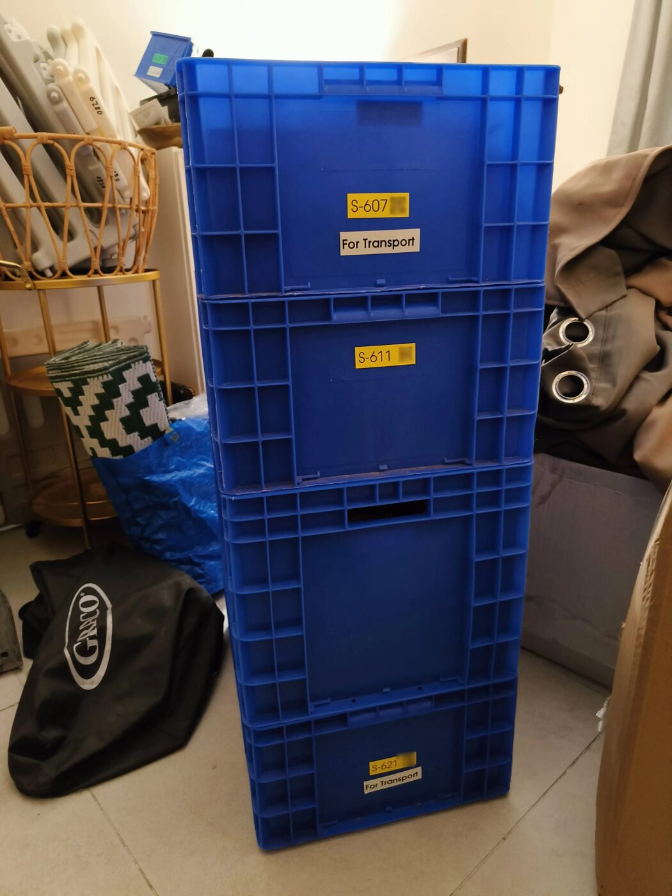
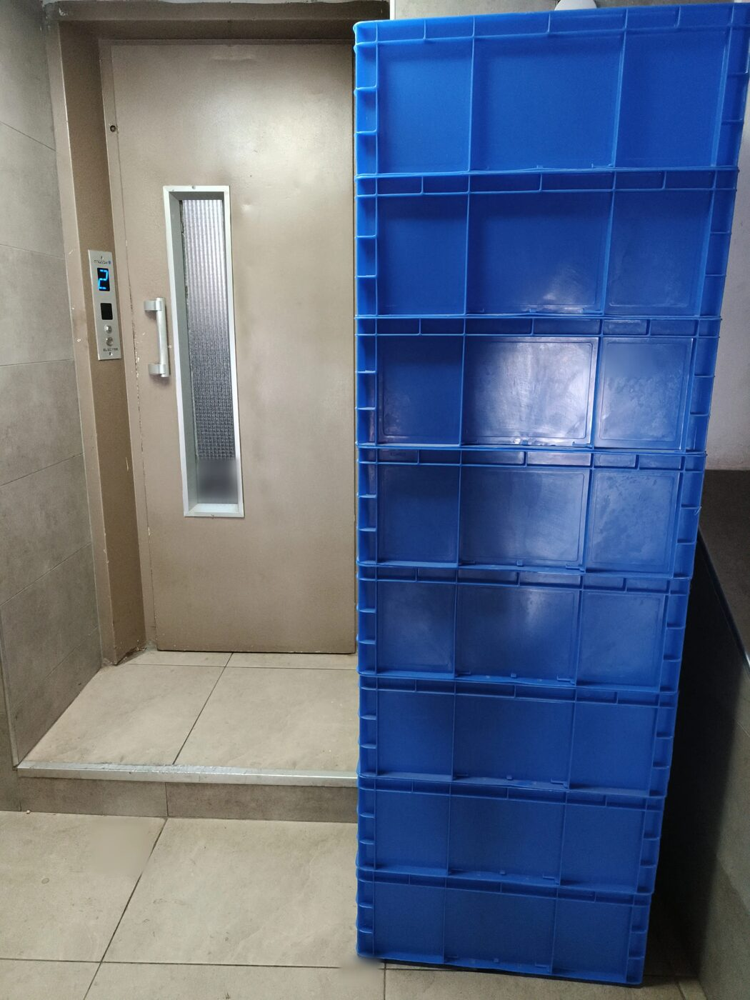
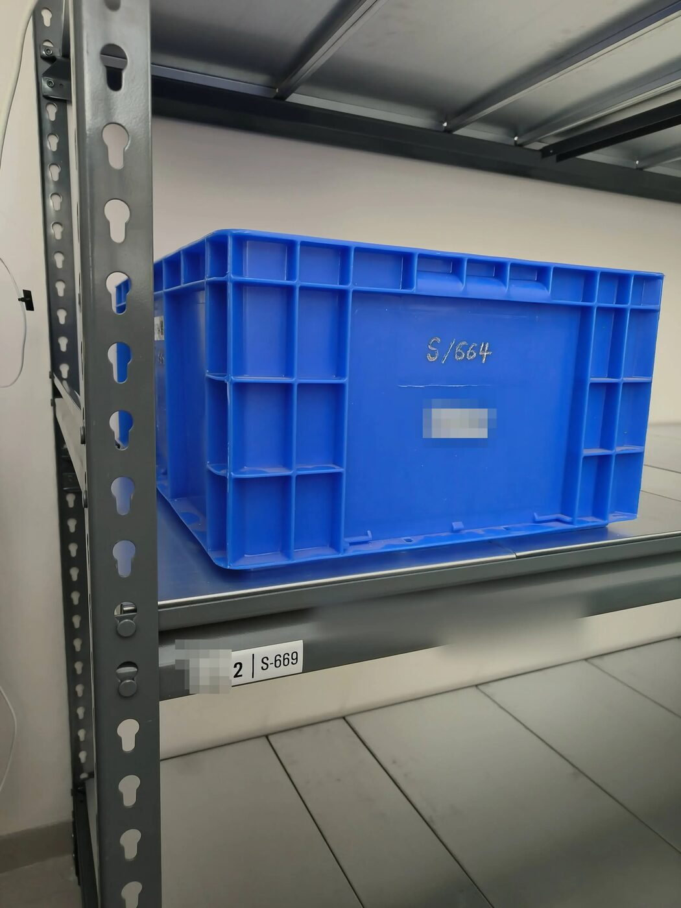

# SOP: The Apartment Move

The core procedure. Origin flat to destination flat, one household, system already in
place.

**Scope.** A domestic move between two residential addresses, where belongings already
live in Euro-footprint containers on industrial shelving and are tracked in an
inventory system. If that's not true yet, run
[SOP: Cold-Start Setup](sop-system-setup.md) first — the timings below assume the
consolidation work was done months ago, and they are meaningless otherwise.

**If part of the load isn't going to the new flat**, run this SOP for the part that is
and [SOP: Split Moves & Storage](sop-split-and-storage.md) for the rest.

## Preconditions

Do not start the clock until all of these are true. Each one that isn't adds days, not
hours.

| Precondition | Why it's load-bearing |
|--------------|----------------------|
| **One footprint** across all containers | Mixed footprints mean no interlocking columns and no pallet tiling |
| **Boxes sealed and labelled** as normal state | Otherwise "packing" reappears as a phase |
| **Inventory current** to within a few weeks | You can only leave a box sealed if you can look inside it in software |
| **Boltless racking** | Bolted or welded shelving is abandoned, not moved — see [Industrial Shelving](industrial-shelving.md) |
| **Wheels + straps on hand** | A column you can't strap is eight lifts, not one push |
| **Both elevators measured** | The single biggest determinant of how long the day takes |

## The two rules

Everything below is an application of these:

1. **Never handle a level lower than you have to.** Move columns, not boxes; boxes,
   not items. Opening a sealed box during a move is a defect, not a step.
2. **Touch each unit once per node.** Off the shelf → onto the staging floor → onto
   the vehicle. A box that gets shuffled around the flat twice has cost you its whole
   handling budget.

## Timeline

| Phase | When | Output |
|-------|------|--------|
| **0 · Survey** | T−6 weeks | Both ends measured; method chosen; quote obtained |
| **1 · Freeze & audit** | T−4 weeks | Purge done; inventory reconciled; zone plan fixed |
| **2 · Consolidate** | T−2 weeks → T−1 day | Everything sealed, zoned, staged as unit loads |
| **3 · Strike the racking** | T−1 day | Shelving flat-packed, fasteners bagged, loaded last |
| **4 · Line-haul** | T−0 | Load at origin, transport, unload at destination |
| **5 · Deconsolidate & put away** | T+0 → T+2 days | Racking up, boxes on shelves, zones cleared |
| **6 · Check-in & close out** | T+1 week | Inventory locations updated; empties nested; gear stowed |

---

## Phase 0 — Survey (T−6 weeks)

You are pricing a lane, not just booking a van.

**Measure at both ends, and write the numbers down:**

- **Elevator internal depth, width and door width.** Depth is the one that decides
  whether a strapped column rides the lift or you take the stairs. A ~56 cm cab is a
  different move from a service lift, and the difference is measured in days — see
  [Pallets, Elevators & Biomechanics](pallets-elevators-biomechanics.md).
- **Doorway and corridor widths**, and every threshold, step and lip on the path from
  the parking space to the flat door. Wheels stop at lips.
- **Parking**: how close the vehicle gets, and whether the last leg is flat.
- **Floor** at both ends: a pallet jack needs hard, level, continuous floor. Carpet,
  gravel and a single step all disqualify it.

**Then choose the method** — this is the decision that shapes everything downstream:

| Method | Choose it when | Consequence for this SOP |
|--------|---------------|--------------------------|
| **Professional movers** | Long distance, bad access at either end, no time, heavy furniture | You do phases 1–3; they do phase 4. Give them a manifest, not a guess |
| **Rented van, self-driven** | Short hop, decent access, a helper available | You do everything; plan for 2–3 runs and one loading discipline |
| **Car shuttle** | Very short hop, no deadline, small load | Many small consolidations rather than one big one; the boot capacity becomes your unit load |
| **Palletized + jack** | Both ends have hard level floor and a tail-lift or ramp | The cheapest handling per kilo you will ever get, and rarely available in residential buildings |

**Briefing a removals firm is different when you're standardized.** Movers price
uncertainty — volume they can't see and handling they can't predict. You can remove
both: give them a count of identical 600 × 400 units, a total cube, and a pallet-load
figure. The [Eurobox calculator](https://danielrosehill.github.io/eurobox-calculator/)
produces exactly this as an A4 PDF; hand it over with the quote request. Ask
specifically whether they carry a **tail-lift** and whether their crew will move
**your** unit loads rather than repacking into their own cartons.

## Phase 1 — Freeze & audit (T−4 weeks)

- **Freeze acquisition.** Nothing new enters the flat that isn't consumable. Everything
  bought now is something you pay to move.
- **Purge before you count, not after.** The cheapest box to move is the one you don't.
- **Reconcile the inventory.** Walk the shelves, scan, fix what's wrong. This is the
  only phase where opening boxes is correct, and it is much cheaper now than at T+0.
- **Fix the zone plan.** Take the destination floor plan and name its zones —
  `KIT`, `BED1`, `BED2`, `OFF`, `STORE`, `BATH`. These names become the only human-
  readable thing on the outside of a box. Decide now which zone the shelving goes in;
  it determines the unload order.

> **The most common failure of the whole system is a stale inventory.** If check-ins
> lapsed, every sealed box becomes an unknown, and unknowns get opened. Budget the
> reconciliation as real work.

## Phase 2 — Consolidate (T−2 weeks → T−1 day)

For a system already in place, this is mostly **labelling and staging**, not packing.

1. **Decant the awkward set into ACLs.** Bedding, coats, kitchen miscellany, the
   half-used contents of drawers. Attached lids can't be lost, seal with a cable tie,
   and nest empty afterwards — see
   [Attached-Lid Containers](attached-lid-containers.md). Everything already shelved in
   Euroboxes stays exactly as it is.
2. **Seal.** Cable tie through the hasp on ACLs; locking lids down on Euroboxes. A
   sealed box is a promise that nobody needs to look inside it today.
3. **Zone-label.** One large, legible destination code per box, on the **short end** —
   the face you'll see when boxes are stacked in a column against a wall. Contents go
   nowhere near the label; they're in software.
4. **Interlock into columns** by zone and by weight: heavy low, light high, and
   **never mix zones within a column**. A mixed column has to be broken down at the
   destination door, which is a deconsolidation you didn't need.
5. **Strap each column** into one rigid object. This is the step people skip and the
   step that turns eight lifts into one push.
6. **Stage at the dock.** Clear a defined floor area near the exit — you are building a
   loading dock in your living room. Nothing enters the dock unsealed or unlabelled.
7. **Palletize, if and only if phase 0 said you could.** Four footprints per layer,
   wrap, strap, done.



*End state of phase 2: sealed, zone-labelled, interlocked, strapped. Nothing here will
be opened again until it's on a shelf in the new flat.*

**Reserve one "open box" per person.** Kettle, chargers, tools, medication, the rubber
mallet. It travels in the cab, not the load, and it is the only container exempt from
the seal rule. An open-front [picking bin](picking-and-sorting-bins.md) is ideal —
you'll be grabbing from it one-handed all day.

## Phase 3 — Strike the racking (T−1 day)

The racking comes down **after** the boxes are off it and **before** the vehicle
arrives.

- **Unshelve top-down**, one bay at a time, straight into columns at the dock. Don't
  half-empty three bays.
- **Unbolt from the wall**, then knock the beams up and out with the rubber mallet.
  Boltless racking comes apart in the order it went together, in minutes.
- **Bag and tape the fasteners to an upright.** Wall anchors, brackets, spare keyhole
  clips. Loose fasteners are the single most likely thing to be lost in a move and the
  single most annoying to replace.
- **Flat-pack and band the uprights, beams and decks** into three bundles by type.
  Count the beams and write the count on the tape — you will want to know at the far
  end whether a bay's worth is missing.
- **Photograph a built bay before you strike it** if the pitch took work to get right.

**Load the racking last.** It is the first thing you need at the destination — see
phase 5 — and last on means first off.

## Phase 4 — Line-haul (T−0)

**Load order is unload order, reversed.** Racking last on. Zone by zone otherwise, with
the zone you'll unload first loaded last.

- **Load in unit loads.** Strapped columns go on the tail-lift or up the ramp intact.
  Break a column only if the lift forces it.
- **Fill the vehicle floor-first, and tight.** Gaps let loads walk. Euroboxes tile
  against each other; use that.
- **Heavy low, over the axle.** Same biomechanics as the shelf, different reason.
- **The lift is the bottleneck, not the van.** If the cab is shallow, run a two-person
  relay — one working the flat-to-lift leg, one the lift-to-vehicle leg — rather than
  having both people wait on the same lift cycle.



*A proper service lift takes a whole strapped column in one cycle. A 56 cm cab takes
two boxes and your patience.*

**If movers are doing this phase**, your job is to protect the unit loads: tell the
crew, on arrival and in one sentence, that the boxes are sealed and self-contained,
that nothing needs repacking, and that columns are strapped deliberately. Then get out
of the way and manage the destination end instead.

## Phase 5 — Deconsolidate & put away (T+0 → T+2 days)

Mirror image of the origin, in strict order:

1. **Set up the destination dock first.** Clear floor, near the door, out of the
   traffic path. Everything lands there before it goes anywhere.
2. **Build the racking before a single box goes on a shelf.** It's the first thing off
   the van for exactly this reason. Rubber mallet, set the pitch to your box heights
   (box height + 4–5 cm), **anchor to the wall**, then start loading.
3. **Route by zone, don't open anything.** Every box goes to its zone on the label.
   Boxes for a zone that isn't ready stay strapped in a column at the dock.
4. **Cross-dock what you can.** A box whose shelf already exists should go from the van
   to the shelf without touching the floor. Every floor-landing is a lift you pay for
   twice.
5. **Decant ACLs into Euroboxes** as their shelves come online — straight walls use
   shelf volume better and the permanent lid stops being an obstruction. Nest the
   emptied ACLs immediately; they're the bulkiest thing in the flat once empty.
6. **Unpack on demand, not on principle.** A sealed, shelved, inventoried box does not
   need opening because it arrived. This is the payoff for the whole system: the move
   ends when the boxes are on shelves, not when they're empty.



*The move is finished at this point, not when the boxes are empty. Anything still
sealed is storage, not backlog.*

## Phase 6 — Check-in & close out (T+1 week)

- **Update locations in software.** Ideally a bulk update: same boxes, new addresses.
  This is the difference between a data edit and a memory test.
- **Nest the empty ACLs** and stow them — a nested stack is a fraction of the volume of
  the same count of straight-wall crates.
- **Stow the gear**: straps coiled, dolly against a wall, mallet back in the tool box.
  It gets used again sooner than you'd like.
- **One ACL on the platform trolley becomes the rolling trash cart** for the unboxing
  phase — liner over the rim, lid closed on top of it. See
  [Moving Equipment](moving-equipment.md).
- **Write down what went wrong**, while it's fresh, in whatever document you'll actually
  find next time.

## Known failure modes

The ones that have actually cost time, rather than the theoretical ones:

| Failure | Cost | Countermeasure |
|---------|------|----------------|
| **Stale inventory at T−0** | Every box becomes an unknown; sealed boxes get opened "to check" | Phase 1 reconciliation is not optional |
| **Repacking into a new format mid-move** | A full manual re-check-in of every box afterwards — the single most expensive thing in our last move | Never change container format and address at the same time |
| **Shallow elevator discovered on the day** | Whole move drops to stair-carry rates, DIY and professional alike | Measure in phase 0; if it's bad, price the move differently |
| **Mixed-zone columns** | Deconsolidation happens in a doorway, twice | Build columns by zone in phase 2 |
| **Racking loaded first** | Boxes stack in a flat with no shelves to put them on | Racking last on, first off |
| **Unstrapped columns** | Every stack is babysat; nothing can be tilted or wheeled | Straps cost less than one hour of a mover's time |

## The whole SOP on one card

```
  T−6w  measure both lifts · choose method · quote from a manifest
  T−4w  freeze buying · purge · reconcile inventory · name the zones
  T−2w  awkward set into ACLs · seal · zone-label · columns · strap
  T−1d  unshelve top-down · strike racking · bag fasteners · band it
  T−0   racking last on · load by zone · unit loads only · lift is
        the bottleneck
  T+0   dock first · racking up · anchor it · route by zone · never
        open a box
  T+1w  bulk-update locations · nest empties · stow gear · write it
        down
```

## Related

- [← SOPs](sops.md) · [Contents](README.md) · [Split Moves & Storage](sop-split-and-storage.md) ·
  [Moving Equipment](moving-equipment.md) · [Pallets, Elevators & Biomechanics](pallets-elevators-biomechanics.md) ·
  [Where's My Box](wheres-my-box.md)
