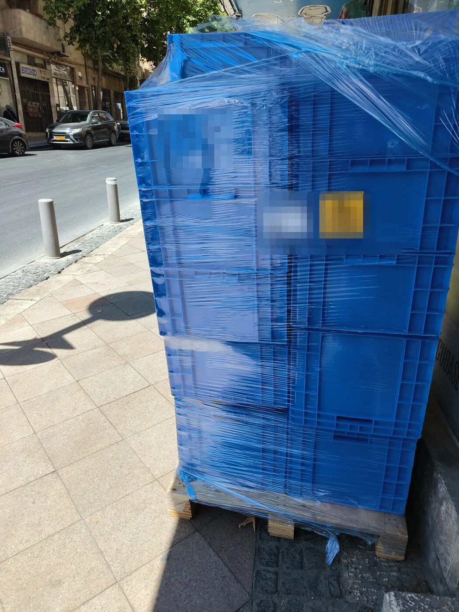

# SOP: Split Moves & Storage

The variant where the load doesn't all go to one place. Part of it lands in the new
flat; part goes to a **storage unit, a business premises, a parent's garage** — or
simply sits somewhere for the weeks between one lease ending and the next beginning.

In freight terms you've gone from two nodes to three, and added a node where the goods
**rest**. That single change drives every rule below: at a resting node, the unit load
is the point. Nothing gets broken down there, ever.

```
                          ┌──► NEW APARTMENT   deconsolidate → shelve
                          │    "live set"      opened within days
   ORIGIN ──► SORT ───────┤
              & tag       ├──► STORAGE NODE    stays consolidated:
              at the box  │    "dormant set"   palletized, sealed,
              level       │                    never opened
                          │
                          └──► OUT             sold · given · binned
```

## When this applies

- **Downsizing** — the new flat won't take everything and you're not ready to shed it.
- **A gap between tenancies** — the near-universal Israeli case where the old lease
  ends before the new one starts, and the household lives out of a suitcase for a
  fortnight. See [The Why](the-why.md).
- **Seasonal or dormant goods** — you own things you use once a year and would rather
  not pay flat-rent to house.
- **A business premises in the mix** — an office, workshop or lock-up you already
  control. This is the best case in the whole manual: real floors, real doors, and
  sometimes a real pallet jack.

## The sort: one decision per box

Do the sort **at box level, during phase 1 of the main SOP**, not on moving day. Every
box gets exactly one of three tags, and the tag is a field in the inventory system as
well as a mark on the label:

| Tag | Meaning | Handling rule |
|-----|---------|---------------|
| **LIVE** | Going to the new flat | Normal [apartment-move SOP](sop-apartment-move.md) |
| **DORMANT** | Going to the storage node | Consolidated once and not touched again until retrieval |
| **OUT** | Not moving anywhere | Sold, given away or binned **before** T−0, not stored "for now" |

> **The dangerous tag is DORMANT.** It's where "I'll decide later" goes to hide, and
> storage rent is a subscription to not deciding. Set a review date on the whole
> dormant set at the moment you create it.

The sort test that works: **would you pay a year's storage rent for this box?** The
rent is knowable — price per m³ per month × the box's cube, and the
[calculator](https://danielrosehill.github.io/eurobox-calculator/) gives you the cube.
For most boxes the honest answer is no, and the tag is OUT.

## Rules for the dormant set

1. **It stays consolidated.** A dormant box is never opened at the storage node. If you
   think you'll need to get into it, it isn't dormant — it's LIVE and it's going to the
   flat.
2. **Palletize it if the node allows.** Four footprints per layer, columns interlocked,
   wrapped and strapped. A pallet is one object to move in, one object to move out, and
   one object to insure.
3. **Nothing on the floor.** The pallet is the deck. Concrete floors sweat, storage
   units flood, and a 15 cm lift is the difference between a wet corner and a wet
   inventory.
4. **Straight-wall Euroboxes, not ACLs, for the long stay.** ACLs earn their keep in
   transit; over months the tapered walls waste cube you are renting by the cubic
   metre.
5. **Front-load the aisle.** Build the stack so the boxes you're least sure about are
   reachable from the door. You will come back for something.
6. **Location is a field.** The storage node is an address in the inventory system like
   any other — `STORE-A/pallet-2/tier-3`. A box you can't locate in software is a box
   you will pay to store and then buy again.
7. **Photograph the built stack** before you close the door, and attach the photo to the
   location record. It's the cheapest possible manifest.



*The dormant unit load: interlocked, wrapped, strapped, on a pallet and off the floor.
It goes in as one object and comes out as one object.*

## Choosing the storage node

Storage is priced on floor area or volume, but the thing that actually costs you is
**access**. Survey it exactly as you'd survey a flat in phase 0:

| Check | Why |
|-------|-----|
| **Drive-up vs. corridor unit** | Drive-up means the van backs to the door and unit loads roll straight in. A corridor unit with a goods lift can add hours |
| **Door width and type** | Roller shutters are usually generous; personnel doors often aren't. Measure against your loaded pallet, not your box |
| **Floor: level, hard, continuous** | A pallet jack is useless on gravel, ramps with lips, or a single step |
| **Goods lift dimensions** | Same rule as the apartment lift — depth decides whether columns ride intact |
| **Ceiling height** | You're renting a footprint; height is free storage. Stack to it, safely and heavy-low |
| **Damp, drainage, ventilation** | Decides whether the pallet rule is a precaution or a rescue |
| **Access hours and notice** | Retrieval at 22:00 on a Friday is either possible or it isn't |
| **Minimum term and exit notice** | The dormant set's real cost is the term, not the month |

**Price it by the cube you actually have.** Because the load is standardized, you can
quote a storage provider a precise volume and pallet count instead of accepting their
"one-bedroom flat" sizing chart, which is built for cardboard and guesswork and errs
generously — in their favour.

## The gap-tenancy case

Old lease ends the 25th, new one starts the 5th. Everything is dormant for ten days,
including things you'd never normally store.

- **Split the dormant set in two: `DORMANT` and `GAP`.** GAP boxes are the ones you'll
  want inside ten days — kettle, bedding, work kit, a change of clothes each.
- **Load GAP last so it's at the door**, on its own pallet or its own column block, and
  record it as a separate location. The whole point is retrieving it without unpicking
  the stack.
- **Don't unpack GAP into wherever you're staying.** Live out of the boxes; they're
  designed for it, and repacking is a phase you deleted on purpose.
- **A short gap is a case for a single storage node, not two.** Splitting the load
  across a garage and a lock-up doubles the retrieval leg and guarantees something ends
  up in the wrong one.

## The business-premises variant

If one end is commercial space, the system stops being a domestic compromise and starts
running the way it was designed to:

- **A loading bay or a level threshold** means the pallet jack is finally viable — and
  the whole load moves at flat effort rather than linear. This is the scenario the
  palletizing argument in
  [Pallets, Elevators & Biomechanics](pallets-elevators-biomechanics.md) is written for.
- **Ask what's already on site** before renting anything: a jack, a sack truck, a
  tail-lift van, a forklift and someone ticketed to drive it. Commercial neighbours
  lend equipment far more readily than residential ones.
- **Book the dock, and book it wide.** Shared loading bays are contended; an unloading
  slot that ends before you do is worse than no slot.
- **Respect the fire and access rules** you don't have at home: don't block routes,
  don't stack to the sprinkler heads (leave the clearance the site specifies), don't
  put a pallet where a forklift turns.
- **Check the insurance question in advance.** Household contents policies frequently
  don't follow goods into commercial or third-party storage. Ask before, not after.

## The return leg

Retrieval is the same SOP run backwards, and it's easier — the hard part, consolidation,
was done at the origin and never undone.

1. **Re-tag before you travel.** Decide in software which pallets are coming out; a
   retrieval trip that turns into a browsing session costs a day.
2. **Take the unit load whole.** Don't debulk in the corridor to make it fit the car —
   book the right vehicle instead.
3. **Deconsolidate at the flat, not at the node.** The node is a resting place, not a
   workspace, and it usually has worse light, worse floor and a meter running.
4. **Close the location out in software** when the last pallet leaves, so the address
   stops appearing in searches.
5. **If a pallet comes back unopened after a year**, that's your answer about the boxes
   on it. Retag them OUT.

## Related

- [← SOPs](sops.md) · [Contents](README.md) · [The Apartment Move](sop-apartment-move.md) ·
  [Pallets, Elevators & Biomechanics](pallets-elevators-biomechanics.md) ·
  [Where's My Box](wheres-my-box.md) · [The Why](the-why.md)
