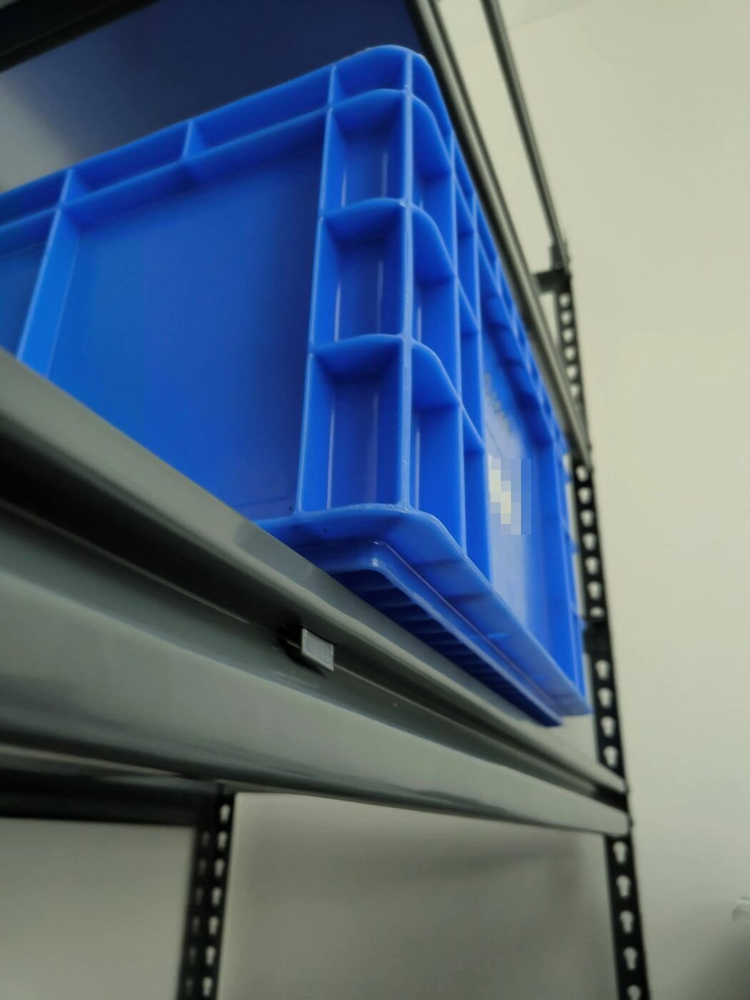

# SOP: Cold-Start Setup

How to get from nothing to the state the other two SOPs assume, without buying
everything at once and without a big-bang weekend that ends in a flat full of the wrong
boxes.

The target state is specific:

> **Belongings live permanently in sealed, identical, Euro-footprint containers, on
> shelving at matching depth, indexed in software.** Packing for a move is then a
> labelling job, not a packing job.

You do not have to reach that state in one move. The system is worth having at 30%
coverage; it just gets better as coverage rises.

## Sequence

The order matters more than the budget. Every step below exists to stop a decision
being taken before the constraint that governs it is known.

| # | Step | Don't skip because |
|---|------|--------------------|
| **1** | **Measure the constraints** | They decide the format, and they're free to find out |
| **2** | **Choose one footprint** | Everything downstream inherits it |
| **3** | **Buy one bay and a test batch** | A wrong choice at scale is expensive and permanent |
| **4** | **Live with it for a month** | Reveals pitch, weight and access mistakes cheaply |
| **5** | **Scale the storage wall** | Now it's just repetition |
| **6** | **Add wheels and straps** | Handling gear is worthless until there's something to handle |
| **7** | **Add the software layer** | Index once, at scale, rather than continuously |
| **8** | **Add ACLs last** | Move-specific kit, needed only when a move is real |

## 1 · Measure the constraints

Before buying a single box, write down:

- **Your lift's internal depth**, and the flat's door and corridor widths.
- **Your car's boot opening and load-floor depth**, if a car will ever carry these.
- **The wall you intend to line with shelving**: length, height, and what's in the way
  (radiators, sockets, window reveals, a door swing).
- **Ceiling height**, minus a hand's clearance for lifting the top box down.

These four numbers decide the shelving, and the shelving decides the boxes. Doing it in
the other order is the most common and most expensive mistake in this whole manual.

## 2 · Choose one footprint

**600 × 400 mm**, in most of the world, for the reasons set out in
[Euroboxes](euroboxes.md) and [Interoperability](interoperability.md): it divides the
Euro pallet exactly four ways, it matches standard 600 mm shelving depth, and it's the
size the whole industrial supply chain is already built around.

The commitment isn't to a *box* — it's to a **footprint**. Heights can vary freely
(12, 23, 34 cm and the 41 cm ACL all share it), and that's the flexibility that makes
one footprint tolerable for a decade.

**If you're outside Euro-pallet territory**, check
[Interoperability](interoperability.md) before defaulting to 600 × 400 — the argument
is "match your region's standard", not "match this one".

## 3 · Buy one bay and a test batch

- **One shelving bay**, boltless/keyhole, 600 mm deep, steel decking, from an
  industrial supplier rather than a DIY shed. See
  [Industrial Shelving](industrial-shelving.md) for depth, beam length, decking and
  load.
- **8–12 boxes**, deliberately in **two or three heights**, so you can find out which
  ones your life actually needs before committing to sixty.
- **Nothing else.** Not the dolly, not the labels, not the ACLs.

Getting hold of industrial stock as a private individual is its own small problem —
minimum orders, B2B pricing, trade-only counters. [Sourcing](sourcing.md) covers what
worked.

*The whole test in one photo: does the box sit fully supported on the shelf, at a
pitch you can lift out of? Find out with one bay, not with the whole wall.*

## 4 · Live with it for a month

Fill the bay with real belongings, not a demo. Then check:

- **Is the pitch right?** Box height + 4–5 cm for hand clearance; more if you lift
  boxes straight out, less if you slide them.
- **Which heights got used?** Almost everyone over-buys the tall boxes and then
  discovers a 23 cm box full of books is already at the limit of comfortable lifting.
- **Can you reach the top shelf loaded?** If not, that shelf is for empties and
  bedding — heavy low, light high.
- **Is the unit anchored?** Anchor it to the wall. Non-negotiable, and especially so
  with children in the flat.

Adjust the pitch now, while shelves are easy to empty. Then buy at scale.

## 5 · Scale the storage wall

- **Buy in one order** where you can — freight is usually the awkward cost, and one
  delivery of many boxes is far cheaper per unit than several small ones.
- **Standardize ruthlessly.** Every non-conforming container you keep is a hole in the
  system: it won't interlock, won't tile on a pallet, and won't sit right on the shelf.
- **Retire the cardboard and the assorted plastic tubs** as coverage grows, rather than
  keeping them "for the garage". The garage is where systems go to become non-systems.
- Costs, and the twenty-year comparison against consumer bins, are in
  [Cost of Ownership](cost-of-ownership.md).

## 6 · Add wheels and straps

Only once there's a wall of loaded boxes does handling gear start earning:

- **A dolly or platform trolley** — rolls an interlocked column instead of carrying
  eight boxes.
- **Ratchet straps** — turn a column into one rigid object. The cheapest force
  multiplier in the kit.
- **A rubber mallet** — the entire assembly toolkit for boltless racking. Keep it with
  the straps.

See [Moving Equipment](moving-equipment.md). A pallet jack is a wishlist item and
genuinely useless in most residential buildings — see phase 0 of the
[apartment-move SOP](sop-apartment-move.md).

## 7 · Add the software layer

Do this **after** the boxes are filled, not before: indexing a finished shelf once is
much less work than maintaining an index while you're still deciding what goes where.

- Stand up an inventory system — [Homebox](https://github.com/hay-kot/homebox) or
  equivalent — and generate **QR labels** for every box.
- **Label discipline**: QR plus a short human code on the short end. Contents in
  software only.
- **One session per bay.** Scan the box, list what's in it, set the location, move on.
  It's dull, it's finite, and it's the thing that lets you leave boxes sealed for
  years afterwards.
- Read [Where's My Box](wheres-my-box.md) first for the **QR privacy** issue — codes in
  photos are readable even when blurred or partly covered, and the batch redaction tool
  in [`../tools/`](../tools/) exists for that reason.

## 8 · Add ACLs when a move is real

[Attached-lid containers](attached-lid-containers.md) are move kit, not storage kit.
Buy a handful — enough for the awkward, bulky, last-week loads — when a move is
actually on the horizon. They share the footprint, so they drop into the system without
changing anything else, and they nest away to almost nothing between moves.

## Don't

| Mistake | What it costs |
|---------|---------------|
| Buying boxes before measuring the shelving and the lift | A format you're stuck with, or boxes that overhang the shelf |
| Mixing footprints "just for these" | No interlocking, no pallet tiling, no column that stays together |
| Chipboard or MDF decking | Sags under sustained load, swells if damp — see [Industrial Shelving](industrial-shelving.md) |
| Sixty boxes in one purchase, all the same height | Discovering in month two that you needed shallow ones |
| Indexing continuously from day one | Maintenance burden before there's anything to maintain |
| Changing container format **during** a move | A full manual re-check-in of the entire inventory — do it before or after, never during |

## You're system-ready when

- Every routine belonging is in a **sealed container on the shared footprint**.
- The **shelving matches the box depth**, is anchored, and comes apart with a mallet.
- **Nothing needs opening to identify it** — the QR answers it.
- A **dolly and straps** are in the flat, not on a wishlist.

At that point [SOP: The Apartment Move](sop-apartment-move.md) is a two-week procedure
instead of a two-month one, and every subsequent move is cheaper than the last.

## Related

- [← SOPs](sops.md) · [Contents](README.md) · [Euroboxes](euroboxes.md) ·
  [Industrial Shelving](industrial-shelving.md) · [Sourcing](sourcing.md) ·
  [Cost of Ownership](cost-of-ownership.md) · [Where's My Box](wheres-my-box.md)
