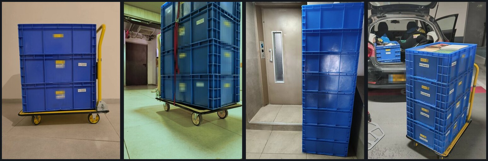

# Standard Operating Procedures

The rest of this manual is about **kit** — which box, which shelf, which trolley.
This section is about **procedure**: the order you do things in, and why that order
is what makes the kit pay off.

The framing is deliberately industrial, because the problem is:

> A domestic move is a **supply chain with two nodes and one very short leg.**
> Everything that logistics does at scale — consolidate, unitize, haul, deconsolidate,
> put away — is exactly what you do between two apartments. The only differences are
> that the nodes are flats, the fleet is a rented van, and you are the labour.

Once you see it that way, the standard moves stop being metaphors and become
instructions.



*Consolidate, unitize, haul, deconsolidate — the same four verbs a freight forwarder
uses, applied to a two-bedroom flat.*

## The model

| Freight term | What it is at home |
|--------------|--------------------|
| **Consolidation** | Turning scattered belongings into a small number of identical, sealed, stackable **handling units** — and then into a smaller number of **unit loads** (strapped columns, or a loaded pallet) |
| **Unit load** | The largest thing one person plus one wheeled device can move as a single object |
| **Line-haul** | The transport leg itself: van, car shuttle, or a removals crew |
| **Deconsolidation** | Breaking the unit loads back down at the far end — but only down to *box* level, not to *item* level |
| **Put-away** | Boxes onto the shelving, in a known location, recorded |
| **Cross-dock** | Freight that never rests at the node — the boxes that go straight from the van onto the shelf without touching the floor |

The whole system exists to make consolidation nearly free. If your belongings already
live in sealed 600 × 400 boxes on a 600 mm shelf, **step 2 of the move was done months
ago** — and what is normally the most expensive, most miserable week of the process
collapses into an afternoon of labelling.

```
 ORIGIN                                              DESTINATION
 ══════                                              ═══════════

  shelving                                              shelving
      │                                                     ▲
      │ 1. unshelve                             6. put away │
      ▼                                                     │
   staging ──► 2. consolidate ──► 3. LINE-HAUL ──► staging ─┘
   ("the dock")   seal · label ·     one leg,     ("the dock")
                  interlock ·        one load    4. deconsolidate
                  strap · palletize               5. route by zone

  racking struck LAST, loaded LAST ─────► unloaded FIRST, built FIRST
```

## The unit-load hierarchy

Every standard in this manual exists to make the next line of this diagram possible.
The rule that falls out of it: **never handle a level lower than you have to.**

```
   item                    tracked in software; never handled individually
    │
    └─ box (600 × 400)     the handling unit — one person, one lift
        │
        └─ column          interlocked + strapped — one dolly, ~8 boxes
            │
            └─ pallet      1200 × 800 = 4 boxes per layer — one jack
                │
                └─ vehicle 20 ft container = 11 EUR-1 floor positions
```

Each level hands off cleanly to the one below it because the dimensions divide — see
[Interoperability](interoperability.md) and
[The Shipping-Container Thesis](shipping-container-thesis.md). Each level also moves
for roughly the same effort as the level above it, which is the non-linearity argument
in [Pallets, Elevators & Biomechanics](pallets-elevators-biomechanics.md).

## Two layers: hardware and software

The SOPs assume both halves of the system are in place:

| Layer | What it is | Covered in |
|-------|-----------|------------|
| **Hardware** | Boxes on one footprint, shelving at matching depth, wheels, straps | Most of this manual |
| **Software** | A home inventory system with QR labels — [Homebox](https://github.com/hay-kot/homebox) or equivalent | [Where's My Box](wheres-my-box.md) |

The division of labour between them is a rule, not a preference:

- **The physical label carries only a destination and a code** — a zone (`KIT`, `BED2`,
  `STORE`) and a QR. Nothing about contents.
- **Contents live in software.** A box's manifest changes constantly; a printed
  contents list is wrong within a week and unreadable under a strap.
- **Location is a field, not a memory.** A move is then a **bulk location update**, not
  a re-learning exercise.

Without the software layer the hardware still moves well, but you lose the ability to
leave a box sealed — and leaving boxes sealed is where most of the time saving is.

## The procedures

| SOP | Use it when |
|-----|-------------|
| [**SOP: The Apartment Move**](sop-apartment-move.md) | The core procedure — origin to destination, system already in place |
| [**SOP: Split Moves & Storage**](sop-split-and-storage.md) | Part of the load goes to a storage unit, business premises, or into a gap between leases |
| [**SOP: Cold-Start Setup**](sop-system-setup.md) | You don't have the system yet and want to get to the state the other two assume |

## Related

- [← Contents](README.md) · [Pallets, Elevators & Biomechanics](pallets-elevators-biomechanics.md) ·
  [Where's My Box](wheres-my-box.md) · [The Why](the-why.md)
